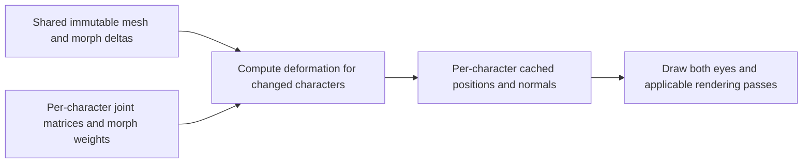

# Morph buffer reuse and the skinning cache

2026-10-27 · Fix: `e8db064b`

When any character needed deformation, we were copying the **entire global
morph-delta buffer** from CPU memory into a new GPU buffer. Mesh loading had
already uploaded and retained this data. The fix makes deformation use that
existing buffer.

## How the machinery fits together

A morph target describes changes to a mesh's vertex positions and normals, such
as the shape of a blink. Its weight controls how much of that shape to apply.
The shape data stays constant while its weight can change.

| Data | Ownership and lifetime |
| --- | --- |
| Base mesh, joint indices/weights, morph-target deltas | Immutable mesh data, shared by copies of the same avatar |
| Joint matrices and active morph-target weights | Per-character inputs that change with pose or expression |
| Final deformed positions and normals | Per-character output retained in the GPU skinning/deformation cache |

The compute shader applies the active morph deltas, then joint skinning, and
writes the result into that character's cache range. The drawing shaders read
those cached vertices and apply the model/camera transforms. Unchanged pose and
morph inputs allow the previous output to be reused across frames. Both eyes
can consume the same deformation result.

## What went wrong

The output cache was working: stationary Lumae were not being deformed again.
However, whenever another character changed—such as the tracked player—the
deformation batch rebuilt its morph input buffer by:

1. Cloning the full CPU morph arena, containing deltas from all uploaded meshes.
2. Allocating a staging buffer and a new GPU storage buffer.
3. Copying the full arena to the GPU before running the dirty characters' jobs.

This happened even when those jobs had no active morph targets. Loading Lumae
grew the arena from **7.66 MB to 15.26 MB**, so moving the player also transferred
Lumae's unused deltas. A second Lumae shared that mesh data rather than doubling
the arena again. Disabling hair springs did not remove the player's updates.

## What the fix changes

Deformation now binds the retained GPU morph arena created during mesh loading.
Per-character weights, joint matrices and cached outputs retain their existing
independent behavior. Skin-only scenes keep a reusable zero entry to satisfy
Vulkan's requirement for a nonempty descriptor buffer.

When a newly uploaded mesh extends the arena, mesh loading creates and uploads a
replacement. Older recorded GPU commands retain references to the previous
buffer until their work finishes. This preserves their data without adding a
per-frame upload or overwriting a buffer still in use.

In headset captures, steady-state morph-delta uploads fell to **zero**, and
deformation allocations fell from nine to seven per active batch. With two
Lumae, CPU preparation/submission for both eyes fell from **9.37 to 4.06 ms**.
Overall app cadence remained near 37 FPS because other work and runtime pacing
still matter. GPU readback tests verified different poses/weights, arena growth
and retained older recordings; all 35 focused tests passed.

The [full profiling report](../task/sakura-rooftop-cpu-profile.md#2026-10-27-first-optimization-reuse-the-immutable-morph-arena)
contains the measurements and limits. The relevant implementation is
[deformation recording and mesh upload](../../src/engine/graphics/vulkano_renderer.rs),
the [compute shader](../../assets/shaders/mesh-deformation.comp), and the
[cached drawing shader](../../assets/shaders/cached-skinned-toon-mesh.vert).
