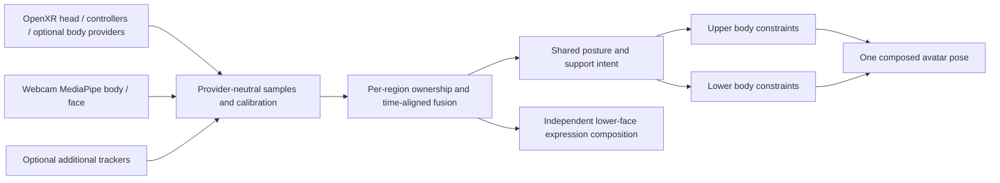

# Avatar posture solvers and tracking: inventory and behavior plan

Status: documentation only. Upper-body expansion, posture coordination, body
tracking providers, and fusion below are proposals, not additions to this branch.
Inventory checked against the current multiplayer/AVC implementation.

## What exists

| Responsibility | Current implementation | Limit |
| --- | --- | --- |
| Head/neck/body placement | AVC plus `HeadNeckBodyConstraintSystem`; mapped rest geometry, neck pitch/roll sharing, head-driven body placement and yaw | Not a general multi-segment spine/chest/pelvis solver or locomotion lean system |
| Compatibility body follow | `HeadPoseBodyXzFollowSystem`, mutually exclusive fallback | Historical name understates XYZ following; not a second concurrent body owner |
| Arms | Per-arm two-bone IK, bend-plane constraints, hand targets and smoothing | No coordinated whole-torso reach/contact policy |
| Legs/posture | `LowerBodyIkSystem`: sole calibration, crouch leg response, support queries, walking/stance/swing, airborne handling | No complete crawling, prone, supine, or roll-over behavior |
| Camera/eye origin | AVC camera wrappers and explicit `eye_offset` shared by local and camera-free rigs | Avatar calibration is distinct from physical tracking-floor calibration |
| Source pose | OpenXR head/controller targets; generic PoseInput for scripted/network targets | Head and hands do not uniquely determine a body posture |
| Fingers | Shared HandTracking selection/retargeting with an OpenXR provider | MediaPipe hand adapter remains planned |
| Eyes | XREyeTracking selection, HTC/VRChat OSC paths, semantic eye/closure routing | Availability depends on provider/runtime; MediaPipe eye entry is a placeholder |
| Mouth/audio | Existing amplitude/viseme mechanisms and morph ownership | No implemented webcam lower-face or body fusion; demo has no network voice |
| Body/face providers | Designs for MediaPipeSystem, FullBodyTracking, LowerBodyTracking, LowerFaceTracking, WebcamEyeTracking | These new consumers/provider bridge are not implemented |
| Multiplayer | Binary typed root/head/hand/blink channels; local IK and secondary motion on both copies | Rich posture intent, body tracking and tracking ownership are not yet replicated |

Source families: `src/engine/ecs/system/ik/head_neck_body_constraint.rs`,
`head_pose_body_xz_follow.rs`, `ik/lower_body/`, `avatar_control_system.rs`,
`hand_tracking_system.rs`, and `openxr_system.rs`. Existing proposals are linked
below; this inventory does not supersede their provider/lifecycle contracts.

## Intended upper-body behavior without sufficient tracking

A proposed `UpperBodyIkSystem` would extend or compose the existing head/neck/body
constraint, not run another competing torso/root writer beside it. Naming and
public MMS configuration are still open. Its procedural authority is limited to
untracked or explicitly delegated channels, including partial tracking loss.

- Distribute bend/twist across pelvis-to-chest spine segments, shoulders and neck;
  avoid placing all bend in one joint. Retain bind pose, segment lengths and scale.
- Small lateral torso lean for sideways locomotion, with configurable roll,
  response and limits. Decide how much follows velocity versus acceleration:
  steady strafe style and turning/acceleration balance are separate signals.
  Distinguish physical HMD translation, commanded locomotion and teleportation;
  head bob and packet jitter must not create artificial lean.
- Forward/back balance for acceleration/deceleration, turning, and leaning/reaching.
  Coordinate shoulder/arm reach with torso and pelvis feasibility rather than
  stretching limbs or silently dragging the tracked hand target.
- Participate in crouching: chest pitch, spine curvature, shoulder placement and
  head/neck compensation. Lower-body IK supplies compatible hip/knee/foot posture.
- Preserve authoritative HMD/eye poses and valid hand/controller targets. Adjust
  visual anatomy underneath them; avoid camera drift, accumulated offsets and
  competing writes from head, arm and body solvers.
- Provide sensible desktop behavior when no hand tracking is present, including
  held-object pose intent. Synthetic desktop hands are a separate pending feature.

Procedural leaning is stylistic fallback, not an estimate of measured human
motion. A tracked torso region must not receive additive lean unless explicitly
configured and bounded.

## Postures are coordinated contact modes

The requested vertical progression is useful for authoring, but not a classifier
based only on HMD height. Orientation, available joint observations, contact and
explicit user/MMS intent also matter. A low head could mean kneeling, sitting,
crawling or lying down. Provide explicit selection/override and conservative
fallback for ambiguous head-and-hands-only input.

| Mode | Upper-body responsibilities | Lower-body/support responsibilities |
| --- | --- | --- |
| Standing / walking | Head/neck alignment, torso balance/lean, shoulders and reach | Pelvis feasibility, stance feet, stepping and ground contact |
| Crouching / squatting | Forward torso compensation, spine/shoulder positioning | Hip lowering, knee flexion, grounded soles and balance limits |
| Kneeling / sitting | Appropriate torso/pelvis relationship and head freedom | Knee/seat contacts, folded legs, feet no longer assumed sole supports |
| All fours / crawling | Near-horizontal torso, shoulder/elbow/wrist support; humanoid imitation of cat/dog posture | Hands/palms plus knees or feet/toes, crawling gait and support transitions |
| Prone, on stomach | Horizontal chest/abdomen, supported or raised head, arms/elbows | Chest/pelvis/leg contacts; no standing-foot assumption |
| Supine, on back | Back/shoulder support, neck/head comfort and arm placement | Back/pelvis/leg contacts and relaxed or bent knees |
| Side lying / rolling transitions | Follow-up needed to connect prone and supine without snapping | Contact transfer and collision feasibility; not implemented |

All-fours on knees and all-fours on hands/feet need distinct contact variants.
A hand holding a weapon is not automatically available as a planted support hand.
Sitting/mounted vehicle ownership remains compatible with the existing attachment
system; do not infer a seated mode solely from height or release mounted ownership.

A shared posture coordinator is a proposed responsibility, not a new component.
It is now called the **body solver**; its first slice (vertical vs horizontal,
hands and knees) is planned in [body-solver-horizontal-mode.md](body-solver-horizontal-mode.md).

1. Select posture/contact intent and read currently authoritative observations.
2. Negotiate one feasible pelvis/root-relative target between upper and lower
   constraints. Define one final pelvis writer; solvers must not overwrite each
   other's hip transforms independently.
3. Solve spine/shoulders/arms and legs against that shared target, with bounded
   correction or explicit infeasibility diagnostics. Keep root locomotion ownership
   separate from visual pelvis adjustment.
4. Transfer contacts/ownership smoothly, using hysteresis and timed blending;
   do not independently guess modes on each subsystem or flip on tracking noise.

This replaces crouch responsibility gradually: preserve current lower-body crouch
behavior until coordinated torso/hip behavior proves equivalent or better.

## Tracking ownership and fusion

These procedural solvers supply missing information. FBT is not an all-or-nothing
switch: valid tracked pelvis/feet can coexist with procedural spine or arms, and
tracked upper body can coexist with inferred legs. Use explicit per-region or
per-channel ownership, freshness and quality; avoid overlapping unrestricted
FullBodyTracking and LowerBodyTracking writers.

Proposed pipeline:

- Keep HMD position/orientation authoritative for the local camera. Use valid
  controller/hand wrist poses where available; webcam wrist estimates must not
  pull those measured targets around.
- Retain capture and receipt timestamps, producer/subject identity, coordinate
  space, calibration generation and per-region validity/quality. Never blend
  unrelated times/subjects or count a cached packet as a new observation.
- Calibrate camera intrinsics/extrinsics, coordinate axes/handedness, scale and
  floor relationship to OpenXR stage/local space. Hip-relative MediaPipe metres
  are not OpenXR room coordinates. A single HMD position correspondence cannot
  determine the complete camera-to-stage rotation/translation/scale transform;
  use an adequately constrained calibration procedure.
- Preserve the headset's raw tracking origin. Existing floor correction must
  be applied once at a defined point, not again in both bridge and consumer.
- Derive torso/hip axes from observed shoulders/hips and limb targets where
  possible. Treat unobserved spine curvature, axial limb twist and occluded joints
  as estimates filled by calibrated priors/constraints, not direct measurements.
- On weak/occluded/stale input, release only affected regions smoothly to
  procedural constraints. Reacquire without pelvis jumps, double stepping or
  freezing stale observed feet indefinitely.
- Initially use explicit source policy and constrained retargeting; a Kalman or
  learned fusion model is not required before synthetic/replay validation.
- Keep capture/inference off render/audio callbacks. Reuse one capture owner and
  one body inference result for all body masks; bounded latest-sample delivery.

## OpenXR: more than head and hands is possible

OpenXR can expose additional tracking through optional extensions and action
profiles. It does not guarantee that every headset/runtime supplies a complete
measured skeleton. Discover and enable supported capabilities, inspect validity,
and implement provider adapters; do not assume SteamVR/ALVR/standalone runtimes
expose the same data simply because they run on the same headset.

| API family | Purpose | Mittens status / implication |
| --- | --- | --- |
| Core view/action spaces | Head/eyes and configured input pose actions | Existing head/controller path; not a portable whole-body skeleton |
| XR_EXT_hand_tracking | Articulated hand joints | Existing engine provider; runtime/device availability still matters |
| XR_FB_body_tracking | Runtime body skeleton | Adapter not implemented here; runtime output can be inferred |
| XR_META_body_tracking_full_body | Extends the FB body joint set to full body | Optional runtime-specific capability; no Mittens adapter yet |
| XR_HTCX_vive_tracker_interaction | Additional tracker-role pose actions | Needs provider/action/calibration integration; not automatic avatar FBT |
| XR_HTC_facial_tracking / XR_FB_face_tracking2 | Optional facial expression data | Audit each runtime/backend separately; native lower-face integration is future work |

An extension called body tracking does not establish optical measurement of every
joint. Meta's published body-tracking guide explicitly describes reconstruction
from head and hand/controller inputs. Preserve provider provenance rather than
labeling every runtime body joint as an independent physical tracker observation.

## MediaPipe capabilities and limits

Google documents 33 pose landmarks with hip-centered metric coordinates and
visibility/presence metadata. This can constrain shoulders, hips, limbs and feet;
it does not directly supply separate lumbar/thoracic spine measurements or a
complete avatar bone-rotation stream. Reconstructing upper/lower back curvature
is a solver design decision, especially with a single view or occluded torso.

Face Landmarker provides landmarks and optional expression coefficients. Use it
for observed jaw/lip/cheek expression even while silent; microphone amplitude is
not a mouth-pose sensor. Start by measuring face performance without an HMD.
A headset obscures much of the face, and a standard webcam/Face Landmarker is not
assumed to track the exposed lower half reliably. Validate that combination or
use a dedicated mouth camera/provider. Do not substitute inferred speech motion
for measured silent expression.

Keep lower-face channels separate from blink/gaze ownership. Define explicit
composition with speech visemes: observed expression when valid, independent
viseme/articulation policy, and deliberate amplitude/neutral fallback when absent.
Do not sum every mouth-open driver or suppress expression merely because there
is no speech. Webcam gaze remains a separate capability, not an automatic result
of face/iris landmarks.

## Suggested future slices

1. Inventory/debug view of existing head/neck, arms and legs, plus region ownership.
2. Upper-body standing lean and shared pelvis contract, synthetic inputs first.
3. Coordinated crouch, then explicit kneeling/seated contact modes.
4. Explicit all-fours, prone and supine modes, followed by transitions/rolling.
5. Optional MediaPipe bridge/replay transport and normalized raw landmark display;
   evaluate body and unobstructed lower-face channels independently.
6. Calibrated XR + webcam fusion for pelvis/torso/legs, partial-loss recovery,
   then measured HMD-occluded lower-face feasibility.
7. Optional runtime body/tracker adapters feeding the same semantic contracts.
8. Multiplayer posture/region-ownership/calibration replication when richer inputs
   exist. Send explicit mode/target information needed to resolve ambiguities;
   head/hand/root alone will not distinguish all poses. Do not network raw camera
   video or bake provider-specific names into avatar components.

Synthetic/replay gates precede hardware inference: known pose/ground truth,
coordinate transforms, time offsets, partial occlusion, provider restarts, long
steady-state runs, rig scale, camera invariance and local/remote consistency.
All slices here are deferred from the current multiplayer implementation branch.

## References

- [Current head/neck/body constraint task](xr-head-neck-bend-and-body-offset.md)
- [Current lower-body/walking task](procedural-lower-body-walking-ik.md)
- [Standing/sole calibration](avc-vr-standing-height-and-sole-floor-calibration.md)
- [Generic tracking component design](avatar-tracking-components-and-mediapipe.md)
- [Shared optional MediaPipe process](optional-mediapipe-tracking-bridge.md)
- [MediaPipe LAN/body/lower-face plan](mitten-droid-mediapipe-tracking-stream.md)
- [Native/streamed tracking roadmap](native-openxr-and-streamed-avatar-tracking.md)
- [Khronos FB body tracking](https://registry.khronos.org/OpenXR/specs/1.1/man/html/XR_FB_body_tracking.html)
- [Khronos full-body extension](https://registry.khronos.org/OpenXR/specs/1.1/man/html/XR_META_body_tracking_full_body.html)
- [Khronos tracker interaction](https://registry.khronos.org/OpenXR/specs/1.1/man/html/XR_HTCX_vive_tracker_interaction.html)
- [Khronos hand joints](https://registry.khronos.org/OpenXR/specs/1.1/man/html/XR_EXT_hand_tracking.html)
- [Khronos HTC facial tracking](https://registry.khronos.org/OpenXR/specs/1.1/man/html/XR_HTC_facial_tracking.html)
- [Khronos face tracking 2](https://registry.khronos.org/OpenXR/specs/1.1/man/html/XR_FB_face_tracking2.html)
- [Meta body-tracking guide](https://developers.meta.com/vr/documentation/native/android/move-body-tracking/)
- [Google Pose Landmarker](https://developers.google.com/edge/mediapipe/solutions/vision/pose_landmarker)
- [Google Face Landmarker](https://developers.google.com/edge/mediapipe/solutions/vision/face_landmarker)
