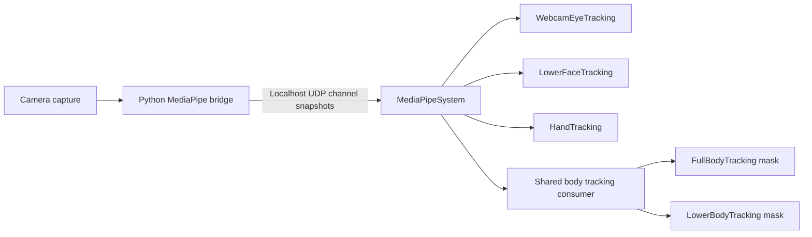

# Avatar tracking components and the MediaPipe backend

Date: 2026-10-20
Status: documentation design; new component names, provider adapters, and body solvers below
are proposed. This pass changes no runtime source.

Companion: [Optional MediaPipe process and MediaPipeSystem](optional-mediapipe-tracking-bridge.md).

## Public components

Expose the requested tracking capability in MMS, independently of the inference implementation.
Use **`WebcamEyeTracking`**, with a lowercase `c`, as the webcam counterpart to `XREyeTracking`.
MediaPipe is one backend for that component. The other requested components keep generic names:

| Component | Requested avatar output | Current status |
| --- | --- | --- |
| `XREyeTracking` | Eye direction/closure from the configured XR tracking transports | Existing selector for HTC/VRChat OSC; MediaPipe is currently only a reserved, unavailable entry |
| `WebcamEyeTracking` | Webcam-derived eye closure/expressions and any separately supported gaze estimate | Proposed; MediaPipe would be its first backend |
| `LowerFaceTracking` | Jaw, lips, mouth, and cheek expression channels | Proposed |
| `HandTracking` | Individual finger articulation, with explicit wrist authority | Existing generic component; OpenXR implemented, MediaPipe adapter pending |
| `FullBodyTracking` | Body armature pose: pelvis, torso, arms, legs, and optionally skeletal neck/head orientation | Proposed; excludes facial expressions and detailed finger articulation |
| `LowerBodyTracking` | Pelvis/hip and leg/foot pose from a body sample | Proposed restricted view of the same body tracking path |

There is no registered `EyeTracking` spelling today; the existing generic eye component is
`XREyeTracking`. This design adds its webcam counterpart rather than prematurely renaming it.
Backend choice belongs in configuration. The ordinary API should not require separate
`MediaPipeHandTracking`, `MediaPipeLowerFaceTracking`, or MediaPipe-prefixed body components.

The existing `MediaPipeEyeTracking` placeholder and accepted `mediapipe` eye-source configuration
need a deliberate compatibility migration when `WebcamEyeTracking` is implemented. Keep old scenes
parseable during that migration. The placeholder must not start a second camera/receiver or become
functional implicitly when the first hand-only bridge lands. Earlier references to a future
`MediaPipeMouthTracking` are superseded by the generic `LowerFaceTracking` design here.

## Process, transport, and engine ownership

The proposed arrangement is:



The Python bridge runs locally, in its own virtual environment, with explicitly installed models
and camera access. It sends results to a nonblocking UDP receiver bound by `MediaPipeSystem` on
`127.0.0.1`. The bridge is not implemented in this repository yet, and the port remains to be
chosen. The engine receives pose data; it does not need to serve a browser application or receive
camera frames.

One `SystemWorld.mediapipe` owns socket/subscription lifetime, producer/session identity, protocol
validation, sequence handling, calibration metadata, channel normalization, latest immutable
samples, and diagnostics. The semantic tracking systems own source policy, avatar bindings, and
application/release of bone or morph channels. The Python side owns capture and inference.

Capture a camera frame once and share it across enabled inference tasks. Eye and lower-face
outputs can share one Face Landmarker result; full-body and lower-body consumers share one Pose
Landmarker result. Hand inference is enabled when hand data is requested. Consumers do not open
their own cameras or run duplicate inference. For the initial one-way UDP design, the manually
launched bridge is configured with its enabled tasks; subscriptions in Mittens alone do not send
start/stop commands to Python. Managed launch/control is a separate follow-up.

First support one configured producer/camera and one tracked subject. Preserve a common capture
identifier and declared subject association across related channels. Do not merge a hand from one
person with another person's body. Multiple avatars may consume the same subject snapshot;
multi-person selection and multi-camera fusion require a later explicit association policy.

## What MediaPipe can supply

These are provider capabilities to normalize, not promises that every adapter already exists.

### Eyes and lower face

Face Landmarker returns face landmarks, optional expression coefficients, and a facial transform.
The documented result has 478 landmarks and 52 expression coefficients. A single result can
supply eye-expression and lower-face adapters independently.
[Google Face Landmarker](https://developers.google.com/edge/mediapipe/solutions/vision/face_landmarker/python).

Expose optional per-eye closure and supported eye-expression coefficients through the webcam eye
contract. Iris/eye landmarks or expression coefficients may support a calibrated gaze estimator,
but gaze must be a separately advertised, validated capability. The Iris solution explicitly does
not determine the location a person is looking at. Do not label raw iris coordinates as a gaze ray
or manufacture physical pupil-diameter measurements.
[MediaPipe Iris](https://chuoling.github.io/mediapipe/solutions/iris.html).

Expose lower-face coefficients as named semantic jaw, lip, mouth, and cheek channels. Keep
unsupported coefficients absent and distinguish expression strength from detection confidence.
`LowerFaceTracking` routes them through avatar-specific morph/bone mapping; the provider never
contains mitten/Bisket morph names. Eye expressions belong to the eye owner, not the lower-face
mask. Brows/upper-face expressions remain a separate future scope.

Webcam visibility determines capability. A camera that cannot see the eyes, including ordinary
external webcam views of an HMD wearer, cannot make the eye channel available just because the
lower face or body was detected. HMD-occluded/lower-face-only inference needs its own validated
model/camera mode; do not assume the ordinary complete-face model works for that view.

### Hands

Hand Landmarker provides 21 landmarks and handedness. Its world coordinates are in meters,
centered on the hand. Normalize these into `HandTrackingFrame`, with missing OpenXR-only joints
left unavailable and derived palm/segment frames identified as estimates. This supports finger
articulation before any absolute wrist-placement mode exists.
[Google Hand Landmarker](https://developers.google.com/edge/mediapipe/solutions/vision/hand_landmarker/python).

Use stable palm geometry available in the 21-landmark schema, such as wrist-to-middle-MCP and
little-MCP-to-index-MCP directions; do not require OpenXR-only metacarpals or derive the wrist
frame from a curled fingertip. Preserve the existing selected controller/OpenXR wrist while
applying hand-relative finger articulation.

### Body armature

Pose Landmarker provides 33 body landmarks, including visibility/presence information. Its world
coordinates are in meters relative to the hip midpoint. It supplies anatomical landmark estimates,
not an avatar-specific bone hierarchy, bind pose, or complete bone rotation stream.
[Google Pose Landmarker](https://developers.google.com/edge/mediapipe/solutions/vision/pose_landmarker/python).

Publish a provider-neutral body sample containing semantic landmarks, declared coordinate space,
independent validity/quality, and capture/receipt metadata. A shared body retargeting/IK consumer
derives limb directions, bend planes, and target rotations from the owning humanoid map and
immutable rest geometry. Intermediate spine and twist/helper bones need explicit reconstruction
policies. Preserve avatar segment lengths, local translations, and scale in the first body slice.

Root-relative pose is sufficient to begin armature tracking. Absolute avatar/root movement needs
an explicit camera-to-engine calibration, scale/floor policy, and locomotion ownership. Hand-
centered and hip-centered coordinates are different frames; shared timestamps do not make their
origins identical. A face transform is also not automatically a positioned XR head.

## Full-body and lower-body masks

`FullBodyTracking` and `LowerBodyTracking` should be authored components backed by the same
internal body sample and solver, provisionally `BodyTrackingSystem`.

`FullBodyTracking` requests body skeletal channels through the limbs and coarse wrist/foot
frames. Neck/head skeletal orientation can be configured separately. It does not automatically
claim eye bones, facial expressions, jaw animation, or detailed finger joints. Pose landmarks
near the face may help estimate head orientation without enabling face-expression inference.

`LowerBodyTracking` requests hips/pelvis, upper/lower legs, and feet/toes. It leaves torso, arms,
head, eyes, and fingers with their existing owners. Pelvis rotation and global root translation
are separate channels; the component does not silently replace XR locomotion or capsule movement.
A lower-body mask limits application to the avatar; it does not require another inference model
or promise that a camera showing only cropped legs is sufficient for reliable pose inference.

Treat these two components as alternatives on one rig by default. Simultaneous use requires
explicit disjoint bone/channel masks; reject or diagnose overlapping enabled owners. The same
applies to body tracking versus arm IK and other animation/pose drivers. XR HMD/head control,
selected wrist targets, and their arm IK retain authority where configured; a body consumer may
write only the remaining declared channels. Combining existing XR head/controller tracking with
webcam legs is the main `LowerBodyTracking` composition case.

Use the retained owning-GLTF `HumanoidBoneMap` for body binding and `MorphTargetMap`/semantic
face mappings for facial output. New components bind through the avatar's resolved rig; multiple
ambiguous rigs require explicit selection. Do not introduce global bone-name searches.

## Eye and mouth ownership

`WebcamEyeTracking` chooses its webcam backend and exposes the same two-eye semantics consumed
by the avatar. `XREyeTracking` continues to select XR tracking transports. Their transport and
backend choices can differ while their avatar-facing eye contract stays common.

Only one active owner may apply an avatar's eye channels. Enabling both components must require
an explicit selection policy or be diagnosed; never let newest packet timing choose between
webcam and XR eyes. Preserve the [one-shot whole-eye election policy](one-shot-xr-eye-tracking-source-election.md)
for XR discovery and define webcam backend selection at the corresponding boundary. That policy
is still pending implementation; this document does not claim it is already active in runtime.

Lower-face composition remains independent. Microphone amplitude/phonemes, authored expressions,
and visual face tracking must have explicit priorities or channel masks. Do not add jaw-open and
the existing amplitude-driven mouth fallback together accidentally. Expired samples release their
owned channels to the configured authored/rest/fallback pose.

## MMS direction

Illustrative target syntax only: `WebcamEyeTracking`, `LowerFaceTracking`, `FullBodyTracking`, and
`LowerBodyTracking` and their shown builders are not implemented. `HandTracking.new().source(...)`
already exists, while its MediaPipe adapter does not. Shared endpoint/model/camera configuration
belongs to the MediaPipe provider declaration/bridge configuration, not a repeated camera setting
on every consumer. Its exact MMS configuration surface is a follow-up decision.

```mms
AVC {
    WebcamEyeTracking.on().source("mediapipe")
    LowerFaceTracking.new().source("mediapipe")
    FullBodyTracking.new().source("mediapipe")

    T {
        GLTF.new("assets/models/mitten.glb") {
            vroid_humanoid_bone_map()
            HandTracking.new().source("mediapipe")
        }
    }
}
```

The example assumes the usual imported humanoid-map factory. For XR head/controllers with
webcam legs, use `LowerBodyTracking` instead of `FullBodyTracking`, and choose `XREyeTracking`
when the XR eye source is wanted. Missing webcam eye capability does not prevent hand or body
tracking from operating.

## Channels and packet scope

Use independently versioned `hands`, `eyes`, `lower_face`, and `body` messages in one stream
envelope. The two body component masks subscribe to `body`; they are not duplicate wire schemas.
Related messages carry their own sequences, validity, producer timestamp, engine receipt time,
calibration generation, and common capture/subject identity. Independent task callbacks need not
finish simultaneously. Do not combine different capture generations as one supposedly coherent
measurement or keep an absent channel alive with unrelated traffic.

The proposed 1200-byte datagram budget applies per channel message, not to one mandatory packet
containing every model result. Send compact eye parameters and semantic expression coefficients
for normal face tracking. A dense face mesh needs a separate optional diagnostic/export path;
478 XYZ float32 triples alone take 5736 bytes. A body payload containing one 33-point XYZ set
plus visibility and presence floats takes 660 bytes before header/masks, leaving room within the
budget. Freeze the actual field types, schema IDs, and fixtures before implementation.

Reuse the existing stream restart, ordering, timeout, invalidation, and bounded latest-snapshot
rules in the [bridge task](optional-mediapipe-tracking-bridge.md). Provider freshness and capture
availability are distinct from each semantic channel being valid and supported.

## Implementation order and acceptance

1. Freeze the shared stream envelope, channel capability/status contract, and replay fixtures;
   implement `MediaPipeSystem` and a synthetic hands producer before camera inference.
2. Add the optional Python Hand Landmarker path and validate hand-relative articulation on the
   existing hand consumer, including controller-held and camera-loss cases.
3. Add one shared Face Landmarker path, `WebcamEyeTracking` eye expressions and `LowerFaceTracking`;
   document gaze as unavailable until its own estimator/calibration is validated.
4. Add the normalized body sample and shared solver, exposing the lower-body mask first for XR
   composition, then full-body skeletal driving. Validate pelvis/root authority separately.
5. Complete compatibility migration and common component diagnostics without breaking existing
   `XREyeTracking`, `MediaPipeEyeTracking`, or hand-tracking scenes.

Each slice needs replay tests without Python/camera dependencies, loss/restart and partial-output
tests, shared receiver/inference evidence, deterministic channel ownership, and real rig/camera
validation. Full/lower-body masks must preserve bone lengths and never double-drive joints;
enabling eye or face consumers must not change hand/body stream identity or freshness.

Open implementation decisions: endpoint/port and exact wire layout, supported Python/model/device
versions, provider configuration syntax, body masks and root calibration UX, eye gaze estimator,
and practical camera framing/performance. The component spellings and provider/consumer ownership
above are the current design direction; none of these unresolved details authorize runtime edits
in this documentation pass.
