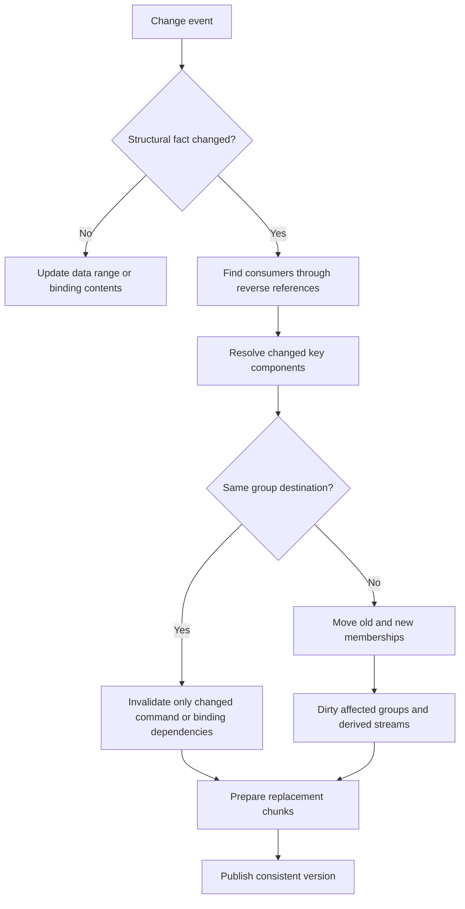
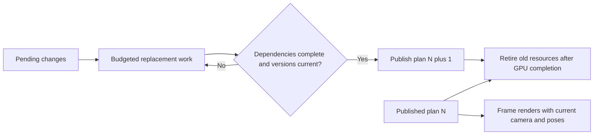

# Proposal: retained sort-key components and draw groups

Status: proposal only, requested 2026-11-08. No storage or grouping redesign is
implemented by this document. The separately authorized first implementation is
more careful invalidation of the existing pass caches.

## The idea

Resolve the structural facts about an object once, remember where those facts
placed it, and revisit only the affected facts/groups when something changes.
A moving camera or an updated joint matrix should not require looking up that
object's material definition, choosing its opaque bucket and classifying its
render phase again.

There are two different levels of retention:

1. **Cache resolved fields.** Keep the material/pass/bucket/binding/geometry
   portions of the key. This avoids repeated resolution but can still leave us
   sorting a whole flat array after a change.
2. **Retain membership and group order.** Keep objects in stable groups and
   maintain the group directory incrementally. A changed object moves between
   a small number of groups; unrelated groups are untouched.

The second level is what could avoid whole-list rebuilding. A large tuple is
not inherently the expensive part: repeatedly resolving it for unrelated items,
sorting them and rebuilding their dependent streams is the work to avoid.

Our current steady frames already reuse their draw structure and eligible GPU
recordings. Benefits must be measured during real structural changes, rather
than claimed as savings on every unchanged frame.

## Where this fits

A **logical pass** describes GPU work, inputs/outputs and ordering dependencies.
A **draw stream** is the ordered draws and clip operations inside that work.
One pass can consume several retained chunks; some passes are compute/fullscreen
operations without an ordinary object draw list. These are related concepts,
not interchangeable names.

Opaque bucket hints are subdivisions inside the regular opaque phase. They do
not create three render passes or three independent depth buffers. Existing
stencil scopes and material/texture/mesh batching remain part of the ordering.
Several logical phases currently share a Vulkan dynamic-rendering scope; CPU
chunk boundaries should not imply ending that scope or storing/reloading tiles.


The diagram is a proposed dependency structure, not a promise to replace all
existing buffers or require one Vulkan command buffer for every box shown.

## Proposed storage

The names below are illustrative internal types, not new MMS API.

### 1. Stable logical draw items

```rust
struct DrawItem {
    source: ComponentId,
    resolved_material: MaterialKeyId,
    geometry: GeometryId,
    clip_scope: ClipScopeId,
    memberships: SmallMembershipList,
    structural_generation: u64,
    // Transform/color/joint data live in the existing mutable data path.
}
// DrawItemHandle contains a logical index plus a reuse generation.
```

Keep items in a generational arena. Removing an item invalidates its handle;
reusing the arena position cannot accidentally resurrect an old reference.
This is a logical object slot, unrelated to eye index, swapchain-image index or
frames-in-flight storage slots.

Current global VisualInstance removal uses swap_remove. A future stable-item
layer must account for that mapping; keeping raw indices into the current vector
would invalidate supposedly retained memberships when an unrelated item moves.
Stable logical handles alone do not solve GPU buffer offsets (covered below).

### 2. Shared resolved material/key components

```text
Material-definition component:
    Surface contract + opaque bucket + static/deformed program identity

Binding component:
    material-instance identity + texture source + sampler/filtering identity

Geometry component:
    mesh identity + geometry interface + index/range generation
```

Many items can share these records. Store reverse references such as
`definition -> material instances -> draw items` and `mesh -> batches` so a
resource change does not require scanning every draw item to discover consumers.
Some of this material-consumer tracking already exists; inventory and reuse it.

Separate **contents** from **recorded identity**. A changed rim strength stored
in a stable uniform buffer is not automatically a new ordering key. A replaced
descriptor set or buffer range can require new recorded bindings even when the
logical material identity is unchanged. Track those dependencies explicitly.

For mirrors, retain the symbolic view-texture source. Resolve the actual capture
image for the current view in the binding layer. Do not put each eye's changing
capture texture into global object membership and recreate the old per-eye
structural invalidation problem.

### 3. Group directories and member lists

One possible hierarchy for ordinary reorderable opaque geometry:

```text
pass
  clip scope
    opaque bucket: Near | Middle | Far
      compatible pipeline/binding group
        geometry batch
          member draw-item handles
```

These need not be nested heap-allocated nodes. An implementation could use pooled
arenas and compact keyed directories with small ordered arrays of group IDs.
Use hash lookup for membership where useful and explicit ordered directories for
execution. Do not make the renderer walk a general object tree per draw.

A batch might retain:

```rust
struct GeometryBatch {
    key: BatchKey,
    members: Vec<DrawItemHandle>,
    topology_generation: u64,
    recorded_binding_generation: u64,
    // Optional later: a stable GPU member/range allocation.
}
```

Each item remembers its memberships and positions in those member lists. Removal
can swap-remove *within a batch*, repairing the moved member's back-reference,
without relocating unrelated batches. A batch's storage capacity can grow
geometrically; avoid allocating an independent vector for every object.

Objects can have several memberships: visible opaque geometry, an outline and
an emission extraction subset, for example. Those memberships must be updated as
one coherent change. They are not three copies of its mesh or joint data.

Stencil ordering requires an actual scope identity/path and its generation.
A reused numeric stencil reference alone is not a unique scope identifier.
Clip enter/source/exit operations must remain balanced and in the required order;
material grouping cannot cross them freely. Ordered overlays and per-view
transparency need their own policies, not this opaque grouping by default.

### 4. Dirty work and reverse dependencies

Retain bounded queues/sets for dirty definition records, items, groups, stream
chunks and recorded bindings. Deduplicate repeated changes before rebuilding.
Use generation counters to say which dependency version a cached result includes.

Memory grows with items, groups and dependency edges. There is a real overhead
for handles, back-references, capacity slack and generations. Measure actual bytes
and allocations rather than assuming this representation is free or smaller
than today's flat vectors.

## Typical update

Suppose a material definition moves from Middle to Near:

1. Update its ordering metadata and generation.
2. Use reverse references to find its affected items.
3. Reuse their geometry/binding components; recompute only their group destination.
4. Remove their memberships from the old groups and add them to the new groups.
5. Update dirty group/chunk order and the affected derived emission membership.
6. Preserve unrelated background, transparency and overlay structures.
7. Publish a consistent stream version, then update any recorded GPU work whose
   referenced structure or binding changed.

The old group may become empty and be retired; a matching destination group may
already exist. Reparenting the group itself is another possible optimization
when all its members move together, but it must respect clip scope and bindings.



## Invalidation examples

| Change | Key or membership work | Data/recording work |
|---|---|---|
| Camera moves | No change to static opaque grouping; visibility/order-sensitive work is separate | Update current camera data; view resources as needed |
| Object transform changes | Usually no opaque grouping change | Update transform data; update bounds/visibility if those systems use it |
| Joint/morph pose changes | Usually retain program, geometry and membership | Update joint/weight data and deformation work; bounds may also change |
| RGB color changes | No regrouping if coverage and relevant classification stay the same | Upload changed color data |
| Alpha/opacity changes | Reevaluate pass, outline and emission eligibility; update old and new memberships if needed | Upload data; do not rely only on the coarse opaque/transparent threshold for shader coverage contracts |
| Definition's opaque bucket changes | Update affected Surface memberships/groups | Rebuild affected ordering/recordings; no shader compilation just for the bucket |
| Material rebinds to a different definition | Resolve base/program/bucket/coverage for that consumer | Replace affected bindings; update old/new groups and phases |
| Texture or filtering changes | Change the binding group if those identities are grouping inputs | Resolve descriptors and dependent recordings |
| Mirror capture image changes | Keep symbolic view-source membership | Refresh view-local binding identities/recordings when needed |
| Mesh contents change with the same handle | Often retain membership; geometry generation changes | Upload geometry; update index counts/ranges and dependent commands if those changed |
| Item spawns | Create handle and memberships in affected groups | Publish its data/resources before admitting its draw |
| Item is removed | Remove its memberships and invalidate its logical handle | Suppress stale drawing and retire resources only after pending GPU uses finish |
| Clip hierarchy/source changes | Invalidate affected scope programs and descendants; broad fallback until dependencies are proven | Rebuild balanced clip operations and dependent chunks |
| Light values change | No material grouping change when lights are buffer data | Update light contents; capacity/resource replacement may invalidate bindings |
| Shader/layout or render-target compatibility changes | Invalidate dependent program/binding records; regroup if identities change | Create compatible pipelines/resources and rebuild their dependent recordings |
| Room streams in/out | Apply the item's membership changes; optional room-owned coarse chunks later | Admit/retire resources and recordings coherently |

A native mutation must report its dependencies, or the implementation must retain
a conservative fallback. Missing an edge creates a stale cache, which is worse
than deliberately rebuilding a larger scope.

## CPU retention versus GPU command retention

These are separate achievements. We can retain CPU grouping and still have to
rerecord a large GPU command buffer if its packed instance offsets shift.

Today DrawBatch.start references a packed per-phase instance-index array. Inserting
an early batch can move later ranges even when their members did not change.
Retaining a CPU group does not make those old embedded offsets valid.

Possible later solutions:

- Stable per-group instance ranges, with slack or a range allocator.
- Stable draw-item indices plus a GPU-visible member-index indirection buffer.
- Indirect draw arguments, so selected counts/ranges become mutable buffer data
  rather than new literal commands. This still requires compatible bindings,
  capacity management and correct synchronization.

Choose and measure one rather than assuming all are necessary. GPU storage reused
across frames needs explicit ownership and completion rules; retaining a handle
does not permit overwriting a buffer that a pending frame is reading.

Small retained command chunks may help once their dependencies/ranges are stable.
Avoid one command buffer per object. We already measured that retaining only
secondaries can leave substantial Vulkano analysis in their changing parent.
CPU chunks do not have to map one-to-one to Vulkan command buffers. Preserve
useful batching and tile/attachment locality when choosing that boundary.

## Could rebuilding be spread over two frames?

Yes, as a separate later scheduling feature: keep displaying the last complete
published plan while preparing replacement groups under a work budget. New
objects may appear a frame later, without freezing current camera/pose updates.
The result must be versioned; publishing half an old/new clip program or mixing
incompatible group offsets is not acceptable.



Give immediate correctness requirements priority: deletion, invalid handles,
missing resources and clip/attachment compatibility changes cannot simply keep
using freed or incompatible data. Keep old resources alive, suppress a removed
item safely, or fall back to a synchronous rebuild. Coalesce newer changes and
reject stale worker results using generations. Bound queue age so deferred work
cannot accumulate indefinitely during sustained scene edits.

Simulation workers are another independent design. They could publish immutable
render-facing snapshots/deltas while the presentation path updates head pose and
visual interpolation at frame rate. Collision-authoritative transitions belong
with simulation; visual interpolation should not silently change that state.
This proposal does not move simulation, add interpolation latency or assign
worker ownership of ECS data.

## Suggested slices and acceptance

1. **Careful invalidation now:** keep current sort keys/storage, identify affected
   passes/derived streams and retain broad fallbacks for index/clip changes.
2. **Measure resolved-key caching:** cache selected stable fields with complete
   generations; compare resolution cost, memory and structural-update timing.
3. **Retained membership pilot:** one reorderable opaque scope, with stable item
   handles, old/new group updates and differential comparison to a full rebuild.
4. **Stable GPU references:** choose a range/indirection design and measure how
   much CPU retention survives through instance packing and command recording.
5. **Budgeted publication, if needed:** only after synchronous partial updates
   are correct and observable. Measure plan age and worst-case update latency.

For each slice compare against a full-rebuild control under the same event stream:
steady frames, bucket changes, material/texture changes, opacity transitions,
spawn/remove, room churn and nested clips. Check coverage, ordering, resources,
frame counts and output, not only a lower average time. Preserve historical runs.

Useful counters include key resolutions, scanned items, changed memberships,
sorted groups/items, rebuilt pass/chunk counts, reused groups, packed ranges,
command rebuild reasons, allocations, memory use and oldest unpublished change.
Steady frames should not become more expensive merely to save rare rebuilds.

## Existing documents and Vulkan references

- [Scoped opaque buckets](../../opaque-material-ordering-bands.md)
- [Persistence and command reuse](persistence-and-command-reuse.md)
- [Clipping and command reuse](clipping-and-command-reuse.md)
- [Explicit pass dependencies](pass-dependencies-and-synchronization.md)
- [Khronos: command buffer usage and multithreaded recording](https://docs.vulkan.org/samples/latest/samples/performance/command_buffer_usage/README.html)
- [NVIDIA: Vulkan usage recommendations](https://developer.nvidia.com/blog/vulkan-dos-donts/)

The references describe API/performance considerations. The proposed storage,
change propagation and scheduling above are a design for this engine, not a
claim that those vendors prescribe this exact architecture.
