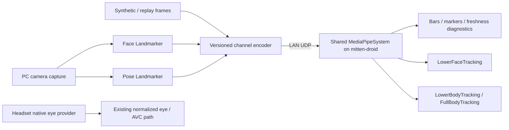

# MediaPipe face/body tracking over LAN UDP to mitten-droid

Date: 2026-11-02
Status: proposed protocol and test slices; no sender, receiver or new component
is implemented by this documentation change.

Parent and ordered native/streaming roadmap:
[Portable native XR and streamed avatar tracking](native-openxr-and-streamed-avatar-tracking.md).
Extends [the optional MediaPipe bridge](optional-mediapipe-tracking-bridge.md)
and [generic avatar tracking components](avatar-tracking-components-and-mediapipe.md).
This explicitly expands the earlier loopback-only proposal to an opt-in LAN
receiver on Android; it does not require adding a general MMS UDP API.

## Smallest useful arrangement

Run inference on the PC initially, in a separately installed Python environment.
Mittens builds and runs without Python, camera libraries or models. Model/version
selection and downloads are explicit bridge setup steps, not engine startup.
The first sender is manually launched; process supervision and discovery come later.

One capture owner feeds configured tasks. Face and body inference may finish at
different times: preserve capture ID and subject ID, publish each independently,
and do not wait for a slow model to transmit a newer completed channel. Use bounded
latest-frame mailboxes rather than an accumulating inference queue. Start with
one camera/subject and a configurable 30 Hz send ceiling per channel; measure and
adjust it independently of the shell's 2 Hz HTTP snapshot throttle.

The [Face Landmarker guide](https://developers.google.com/edge/mediapipe/solutions/vision/face_landmarker/python)
documents optional expression coefficients and facial transforms, including
52 coefficients and 478 landmarks. Send semantic coefficients initially, not the
dense landmark mesh. Map category names into a versioned stable schema rather
than trusting model output order. Left/right refer to the subject; mirror preview
display separately from inference input. Live-stream inference can skip frames
while busy, so the receiver must not expect one result per captured frame.

The [Pose Landmarker guide](https://developers.google.com/edge/mediapipe/solutions/vision/pose_landmarker/python)
documents 33 landmarks and both image and hip-centered metric coordinates. Keep
those conventions distinct. Position samples are estimates, not measured joint
orientations or absolute room coordinates; visibility/presence scores retain their
documented meanings.

## Camera visibility and capability limits

First validate face inference without an HMD. A normal external camera cannot
see eyes behind the headset, and complete-face inference is not assumed to work
on just the visible mouth. While wearing VR, native headset eyes remain the eye
owner; body can still be usable while the face channel is unavailable.

An HMD-mounted/lower-face camera or specialized occlusion-tolerant model is a
separate measured provider mode. The user owns an eye tracker; this does not imply
a lip tracker or suitable mouth camera is connected. Do not promise lower-face
tracking while worn until that camera/model combination passes a test.

MediaPipe iris landmarks are not automatically gaze rays: the
[Iris documentation](https://chuoling.github.io/mediapipe/solutions/iris.html)
explicitly distinguishes iris tracking from estimating where someone looks.
Any future webcam gaze estimator needs a separately validated capability and
calibration. Eye expressions/closure and lower-face coefficients must not make
unobserved gaze valid.

## Engine ownership

Keep the planned `SystemWorld.mediapipe` as one endpoint/session owner. It handles
bounded receive/decode, protocol state, timing, normalization and diagnostics,
then publishes immutable channel snapshots. Semantic consumers own source policy,
rig mapping and release; the receiver does not mutate avatar bones or morphs.
Two avatars can subscribe without opening competing sockets. Final unsubscribe
releases the receiver. No subscriptions means no engine receive/decode work;
a manually launched Python bridge keeps capturing until it is stopped separately.

Reuse `WebcamEyeTracking`, `LowerFaceTracking`, `HandTracking`, `FullBodyTracking`
and `LowerBodyTracking` naming from the component proposal, not new transport-
prefixed consumer names. Their unimplemented status must stay explicit. Keep
the existing MediaPipe eye placeholder parseable until an intentional migration.

Raw face/body snapshots are separate from rig-specific output. First display
expression bars and a stick skeleton; headless tests can inspect resulting bone
and morph values even before Android skinning/morph rendering is implemented.

## Proposed datagrams

Freeze a binary format with Python/Rust golden fixtures in roadmap slice 6.
The layout here is a concrete starting proposal, not a released protocol.
Use explicit little-endian fields and float32 values; decode fields rather than
casting network bytes to native structs. Maximum **1200 bytes including header**;
one complete channel snapshot per datagram, no fragmentation/reassembly initially.

Proposed common header: 64 bytes.

| Field | Bytes | Meaning |
| --- | --- | --- |
| Magic, protocol version, channel kind, header length | 4 + 1 + 1 + 2 | Separate this protocol from the existing HTC eye packet |
| Payload length, flags | 2 + 2 | Exact bounds; reserved bits validated |
| Producer ID, session ID | 8 + 8 | Configured sender identity and fresh restart nonce; not authentication |
| Channel sequence, capture ID, capture monotonic microseconds | 8 + 8 + 8 | Independent sequence per channel; relate completed results to camera frames |
| Subject ID, calibration generation | 4 + 4 | Explicit association; reset affected filters when changed |
| Payload schema ID, coordinate convention ID | 2 + 2 | Defined interpretation; reject unknown values |

Initial channel candidates:

| Channel | Proposed payload | Datagram budget |
| --- | --- | --- |
| Lower face | 64-bit coefficient-validity mask and 52 float32 slots in a fixed named schema; non-lower-face slots invalid | 64 + 8 + 208 = 280 bytes |
| Body | 64-bit landmark-validity mask and 33 records of XYZ, visibility, presence as float32 | 64 + 8 + 660 = 732 bytes |
| Webcam eyes / hands | Separately versioned future payloads; no automatic enablement | Must independently fit 1200 bytes |

No-detection is a valid complete snapshot with empty validity and a corresponding
flag, clearing that channel immediately. A missing datagram does not imply absence
until its receipt-time timeout. A body packet never refreshes lower-face or eye
freshness. Unsupported coefficients/joints remain invalid, not zero-valued
measurements. Freeze permitted ranges, mask bits, coordinate IDs, schema names and
empty-snapshot encoding with the fixtures.

At 30 packets/second per channel the two initial payloads total about 30 KB/s
before UDP/IP overhead. This is a planning calculation, not a measured latency
or performance result. Full face meshes, images, segmentation and model assets
are outside this tracking protocol. Float16/quantization is deferred until useful.

## Receiver, ordering and restart rules

- Bind loopback by default on desktop. Android LAN reception is explicitly
  enabled with a configured interface/port and producer. Candidate port: 7002,
  separate from HTTP 7000, keyboard UDP 7001 and legacy eye ports 9000/9002;
  check availability before freezing defaults.
- Configure the sender with the headset's current LAN IP. ADB USB is for install
  and diagnostics; `adb forward` is not the proposed UDP transport.
- Initially pin one sender endpoint/producer and arm the receiver for one session.
  The first valid packet claims that session; other session IDs are rejected until
  explicit rearm. Restarting Python requires rearm in this first slice. Define
  controlled automatic restart adoption later, rather than allowing delayed old
  sessions to seize ownership repeatedly.
- Reject unknown schema/version, length mismatch, oversized/truncated input,
  illegal masks and nonfinite/out-of-range values before updating any state.
  Source pinning is routing hygiene, not authentication; this first transport is
  for a configured local network, with secure transport a separate scope.
- Reject duplicate/out-of-order sequences per channel/session. Drain with bounded
  packet/byte/time work and publish the newest accepted snapshot. If overload
  tests show the socket stays backlogged, use a bounded receiver worker and
  latest-value mailboxes; never catch up by applying old poses over many frames.
- Use receiver monotonic receipt time for freshness. Sender capture time is in a
  different clock domain; do not subtract it from Android time to claim latency.
  Clock mapping/one-way latency estimation is a separate slice.
- Calibration/session/subject changes invalidate affected filters. Consumers
  interpolate only valid compatible samples, never extrapolate indefinitely,
  and release their channels on explicit disappearance or timeout.

The existing 84-byte HTC/ALVR protocol stays unchanged and remains independently
decodable. Native eyes go directly into typed engine input, not through this UDP
envelope. A future PC relay of native eye data must be explicitly configured and
retain provider/space/timing provenance rather than pretending to be local native
tracking on the receiving headset.

## Combining tracking without fighting XR

Default ownership in VR:

| Output | Owner |
| --- | --- |
| HMD/camera pose and locomotion root | Existing OpenXR + AVC locomotion |
| Eye directions and blink | One selected eye provider; native when selected |
| Controller wrist targets | Existing controller path |
| Jaw/lip/mouth/cheek | Explicit lower-face mapping, if fresh and valid |
| Pelvis/legs/feet articulation | Calibrated lower-body consumer, if enabled |

Start body work with relative articulation and debug markers, not automatic root
translation. Define camera-to-XR axes, reflection, scale, floor and origin alignment;
test recentering and calibration generation changes. Hip-centered model outputs
alone do not establish room-space hip position. Preserve avatar bone lengths and
retarget estimated directions with explicit missing-joint behavior.

Lower-body and full-body are masks over one body sample/solver. Exclude HMD head,
controller wrists, detailed fingers and eye/face channels by default. Enabling
body-driven pelvis translation, head or wrist override requires an explicit later
authority mode. Missing data releases only the affected owner, without resetting
the native eye source or moving the camera.

## Testable implementation order

Follow roadmap slices 6–9 in the parent task:

1. **Headless protocol/receiver:** model-free Python replay encoder and Rust decoder
   fixtures; malformed/oversized packets, sequence loss/reorder/duplicates, empty
   channels, session rearm, calibration changes, two subscribers and bounded work.
2. **PC camera:** explicitly install models/dependencies, validate named lower-face
   coefficients and body axes against recordings, then one live person. Camera
   errors are independent of engine startup. No headset needed yet.
3. **Android synthetic LAN:** optimized APK with bars/stick skeleton, no avatar
   rendering prerequisite. Ask for USB ADB and a worn headset. Send known jaw/leg
   patterns, stop/restart/rearm, then verify receipt age, counts and channel release.
4. **Combined native + streamed data:** keep native gaze/blinks active while body
   packets arrive; exercise one channel disappearing, packet bursts, leaving the
   camera view and disconnecting Wi-Fi. Evaluate worn-HMD face visibility honestly.
5. **Retargeting:** headless fixture rig and desktop avatar before Android visual
   deformation. Calibrate lower body and validate ownership, pose release and
   controller/HMD independence before full-body or absolute-root modes.

Diagnostics expose provider/backend, selected owner, endpoint/session, accepted
sequence, valid-field counts, receipt age, drops/reorders, calibration state and
model availability. Use an opt-in details panel/rate-limited logs, not text rebuilt
for every received sample. Compare XR update/render frame profiles with reception
off/on at identical resolution/refresh and fixed scene content. Record results;
a packet counter alone does not establish useful pose accuracy or latency.
