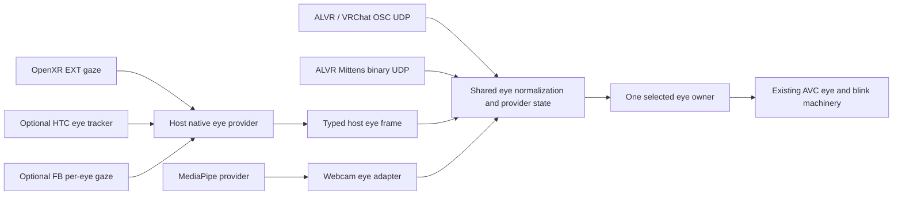

# Portable native XR and streamed avatar tracking

Date: 2026-11-02
Status: proposal and ordered validation slices; no implementation in this task.

## Outcome

An Android VR build of Mittens can obtain eye data from its own OpenXR session,
without ALVR or a UDP round trip, while preserving the existing normalized eye,
AVC, blink, calibration, and rig-mapping machinery. HTC is one optional native
provider, not the Android application's required identity. Headsets without eye
tracking must still start and render normally.

A PC can additionally run MediaPipe face/body inference and send compact UDP
samples to mitten-droid. Native eyes, streamed lower-face expressions, and streamed
body pose can coexist without competing for the same avatar channels. See the
[MediaPipe LAN companion](mitten-droid-mediapipe-tracking-stream.md) for transport,
camera limitations, and protocol decisions.

This extends the [component design](avatar-tracking-components-and-mediapipe.md),
[shared MediaPipe provider](optional-mediapipe-tracking-bridge.md), and
[one-shot eye-source election](one-shot-xr-eye-tracking-source-election.md).
The latter remains the intended selection policy, rather than continuous
per-channel mixing. Existing APIs remain compatible; proposed names below are
not yet usable MMS.

## Source audit: what actually exists

| Area | Current implementation / limitation |
| --- | --- |
| Eye components | `src/engine/ecs/component/xr_eye_tracking.rs`: generic `XREyeTracking`, OSC and HTC source components; `MediaPipeEyeTracking` is an unavailable placeholder |
| Eye ingress | `src/engine/ecs/system/xr_eye_tracking_system.rs`: OSC UDP and 84-byte HTC binary UDP, registered component indexes, normalized `EyeGazeSample` and `EyeClosureSample` |
| Selection | Current resolver selects gaze and closure independently by priority. Bounded election, sample-time liveness, shared receivers, and locked whole-eye ownership are still proposed |
| Avatar output | `avatar_control_system.rs`: direct-child sample routing, eye basis/limits, gaze ownership and closure-driven blink routing; no native API calls belong here |
| Android XR handoff | `ExternalXrFrame` currently carries views, controller poses/input/gamepad only. Android owns the session and passes frames to the engine |
| Android native eyes | Host does not currently enable/sample an eye provider; advertising an extension in its report does not mean eyes are being consumed |
| Other tracking | Shared hand contracts exist; new webcam eye/lower-face/body consumers and `MediaPipeSystem` remain proposed |
| Android avatar visuals | Current mobile renderer rejects skin/morph meshes. Tracking acquisition can be tested with debug rays, markers, and numbers before that separate renderer feature lands |

The existing registered-index work is already in the code. Preserve it: do not
reintroduce per-frame world scans while adding providers. Existing sockets are
still per source component, so receiver sharing is a real follow-up, not a
capability to assume.

## Reuse the actual ALVR implementation

There are two checkouts under `~/_/ALVR`. The custom HTC work inspected for this
proposal is in **`~/_/ALVR/ALVR`**, not the outer checkout. References there:

- `alvr/client_openxr/src/extra_extensions/eye_tracking_htc.rs`: runtime-loaded
  `XR_HTC_eye_tracker` ABI, support query, gaze/pupil/geometric reads, and destruction.
- `extra_extensions/eye_gaze_interaction.rs`: standard EXT support query.
- `extra_extensions/eye_tracking_social.rs`: optional FB per-eye gaze wrapper.
- `client_openxr/src/lib.rs`: extension enumeration/enabling, including extra names.
- `client_openxr/src/interaction.rs`: action setup and `get_face_data`, using VIEW
  reference space for heading-independent gaze.
- `alvr/packets/src/lib.rs` and `server_core/src/tracking/face.rs`: `EyeDataHtc`
  transport and the existing 84-byte little-endian Mittens sink on port 9002.
- `docs/review/htc_eyetracking.md`: historical implementation review and wire layout.

The HTC wrapper's latest local history entry is `5b3c5f1` ("add
XR_HTC_eye_tracker support and diagnostic probe"). Record the exact reused
revision when implementation starts; these paths describe the inspected checkout,
not a promise that upstream ALVR has the same custom sink.

Reuse the narrow API/ABI adapter and its provenance, not ALVR's streaming client,
OpenGL ES renderer, settings schema, probe logging, or platform-name dispatch.
The HTC wrapper already accepts a graphics-generic session; Mittens owns a Vulkan
session. Preserve applicable ALVR license notices when copying code.

The HTC ABI is reconstructed from HTC's reference implementation, with explicit
structure-type values, and is absent from the installed `openxr` 0.19 generated
HTC bindings. It is not a new ABI we need to invent. Before reuse, verify constants,
layouts, handle/null conventions, function loading, and ownership against a pinned
HTC reference revision. Add layout/mock-proc tests. Its helpers currently discard
returned sample times; retain those times in the Mittens adapter where supplied.

Do not generalize the ALVR review's historical PC-runtime limitations into a rule
that native eye tracking is HTC-only. A native API can itself be backed by a
streaming runtime; record the API/runtime provenance rather than claiming it
proves a physically local sensor.

## Portable native provider boundary

Use the active OpenXR session as the native API boundary. Prefer public OpenXR
entry points over loading Wave's separate `WVR_*` lifecycle into that session.

| Native backend | Useful data | Availability rule |
| --- | --- | --- |
| `XR_EXT_eye_gaze_interaction` | Combined gaze pose; no per-eye closure or pupil measurements | Extension, system support, bound active action, and valid orientation |
| `XR_HTC_eye_tracker` | Per-eye gaze plus separately valid pupil/geometric fields | Advertised optional name, resolved procs, system support, created tracker, usable samples |
| `XR_FB_eye_tracking_social` | Per-eye gaze through a separate native adapter | Optional extension, support/creation checks, valid returned eye data; other expression APIs are separate |
| Other vendor extensions | Only explicitly supported capabilities | Add a contained adapter when the device/API can be tested |

The standard path is the first portable implementation; richer vendor paths can
be preferred when genuinely producing data. Evaluate candidates during a bounded
discovery phase, then lock one native backend. Do not fill one backend's missing
blink/pupil data from another backend implicitly. Combined gaze may drive both
avatar eyes under the existing combined-gaze policy, but must remain labelled
combined; it is not measured independent vergence.

The [standard EXT specification](https://raw.githubusercontent.com/KhronosGroup/OpenXR-Docs/main/specification/sources/chapters/extensions/ext/ext_eye_gaze_interaction.adoc)
defines support, action activity and validity checks; an enabled extension is not
proof of live gaze. HTC exposes creation/destruction and distinct gaze, pupil and
geometric calls in its [API reference](https://developer.vive.com/resources/openxr/unity/common-interface/).
The inspected ALVR code notes that its standard/Meta gaze paths were unavailable
on Focus 3; the portable EXT slice can therefore correctly report unavailable
there, with the HTC slice supplying this device's actual native data.

Direct Wave C ABI remains an evidence-gated alternative if OpenXR cannot supply
required data on a tested device, not the default architecture. Wave documents
main-thread restrictions for [start](https://hub.vive.com/storage/docs/en-us/WVR_StartEyeTracking.html)
and [read](https://hub.vive.com/storage/docs/en-us/WVR_GetEyeTracking.html).
The current XR worker must not simply invoke those calls or start a second XR
runtime. Such an adapter would need its own lifecycle/threading validation.

## One normalized engine path

Introduce a provider-neutral immutable eye frame in a focused engine module.
Keep `EyeGazeSample`/`EyeClosureSample` as compatibility projections for current
consumers. Native input must not encode fake UDP or synthesize legacy HTC events
merely to reach AVC.

The frame carries provider identity/generation, independent field validity,
capabilities, combined versus per-eye gaze, optional origins, per-eye closure,
optional pupil/geometric data, coordinate-space identity, sequence and timing.
Openness converts once to closure (`0=open`, `1=closed`). Missing fields remain
absent. Sensor pupil coordinates are not an avatar eye translation or gaze ray.

Store engine receipt time separately from provider sample/request time. Allocate
an engine ingress sequence only for a newly accepted sample, not each cached read.
OpenXR time, remote capture time and engine monotonic time are distinct domains;
do not compare/subtract them without a mapping. Preserve whether the native API
actually returned a sample time instead of labelling a requested prediction time
as a sensor capture time.

Prefer head/VIEW-local gaze at a declared sample time. Preserve the corresponding
head/reference-space relationship for diagnostics. Existing compensation remains
an explicit compatibility policy; do not cancel head rotation twice. Verify
neutral `-Z`, left/right, up/down, one-eye invalidity, and a head turn while fixating
a world target. Build on the existing [sample-alignment investigation](eye-tracking-head-rotation-compensation-sample-alignment.md).

The Android host samples eyes on its existing session thread and publishes them
with the external frame, before semantic consumers run. Factor controller actions
and eye actions so all action sets are attached together once, before session
use; the current `Controllers::new` attaches immediately. Destroy tracker handles
before the session and invalidate samples on session loss, pause and recenter.
Desktop's engine-owned OpenXR path can later publish the same typed frame.

Retain explicit `HTCEyeTracking`/`VRChatOSCEyeTracking` endpoints and existing
events. A proposed native source component and `native_openxr` selector key must
be clearly distinguished from `htc`, which currently means the binary receiver.
Keep the existing priorities parseable; add native preference intentionally and
document it. Do not turn the MediaPipe placeholder on implicitly.

Follow the existing one-shot election proposal: bounded evidence collection,
one whole-eye winner, release unselected subscriptions, stale selected output
releases avatar ownership without switching sources. Provide explicit retry,
especially when startup occurred before the headset was worn/calibrated. Native
eye sampling is subscription-driven; rendering and controller input remain valid
without it. Shared native/UDP providers fan out to multiple avatar subscribers.

## Cross-headset scope

Choose providers using enumerated capabilities and valid samples, not HTC brand
checks. Extension absence, denied access, failed creation, and tracking loss must
produce distinct diagnostics without aborting rendering. No HTC library should
be a mandatory dependency for another headset.

Portability also includes host input/packaging: Android currently suggests only
the Focus 3 controller interaction profile. Audit standard/simple and appropriate
vendor profile bindings, required manifest declarations, loader and Vulkan
binding support in a separate compatibility slice. Eye-provider abstraction alone
does not prove the entire app works on another headset. A second headset without
eyes is a useful real test: launch, view rendering, controllers, and an honest
unavailable-eye state must work. A second device with eyes additionally validates
its provider; support is not claimed until tested.

## Ordered slices and test gates

Each slice ends in a reviewable change; do not require a skinned Android avatar
or MediaPipe installation to complete the first native/transport tests.

| Slice | Deliverable and completion evidence | Hardware needed |
| --- | --- | --- |
| 1 | Shared eye frame/ingress seam and fake native provider. Compare equivalent native/OSC/HTC fixtures through existing AVC gaze/closure outputs; test missing fields, basis, timing and cleanup | Headless only |
| 2 | Bounded whole-eye selection, injectable clock, stale release, retry and shared provider subscriptions. Test native vs UDP priority, explicit overrides, two avatars, removal and no unrelated-world scaling | Headless only |
| 3 | Native capability/status probe and standard EXT gaze adapter on the existing Android session. Debug gaze rays/status instead of an avatar. Verify controller actions still work when eye actions are added | Mock API + cross-build; then ask for USB ADB and a worn headset |
| 4 | Adapt the existing ALVR HTC wrapper into the native provider; preserve returned timestamps and test optional procs/layouts. Verify left/right gaze and blink/open/closed on the user's Focus 3 eye tracker | Headless ABI/normalization tests; then USB ADB, calibrated eye tracker, worn HMD |
| 5 | Cross-headset audit and optional FB/native adapters as available. Mock runtimes with no HTC, EXT-only, FB-only and no eyes; launch on another headset when available | Headless matrix first; non-HTC device later, not a blocker for the Focus 3 slice |
| 6 | Versioned MediaPipe UDP receiver and synthetic/replay sender. Latest-state per channel, loss/reorder/restart tests, two subscribers, bounded CPU/backlog and packet-size fixtures | Headless loopback; no camera/models |
| 7 | PC MediaPipe face and pose capture. One capture owner, named coefficient mapping and body debug skeleton; replay follows the same encoder | PC camera or agreed test recording; no headset |
| 8 | Stream synthetic, then camera results to mitten-droid's configured UDP endpoint. Show validity/age, expression bars and body markers while native eyes remain selected | Ask for USB ADB for install/logs; wear HMD for live observations; LAN carries UDP |
| 9 | Lower-face and calibrated lower-body consumers with explicit ownership. Headless rig/morph outputs and desktop avatar first; test missing joints and timeout release | Headless + desktop; headset only for alignment validation |
| 10 | Android avatar presentation after separately approved skin/morph renderer support; optional gaze-driven foveation consumes native gaze through a dedicated render-time path | Separate renderer slices and on-device GPU/frame-time checks |

Native HTC/EXT acquisition and MediaPipe face/body do not depend on one another;
after the common contracts, MediaPipe slices may be taken before a second headset
is available. The order above prioritizes proving local eyes on the device the
user owns while keeping every implementation independent of HTC-only behavior.

For each hardware gate, first finish headless checks and an optimized APK. Then
ask the user to connect USB for ADB, calibrate/wear the headset, and perform the
specific observations. USB provides deployment/logging, not the tracking data
path. Save capability output, backend/selection transitions, validity counts,
sample age and frame profiles; avoid per-frame gaze logging. A successful build
or advertised extension is not live-tracking verification.
