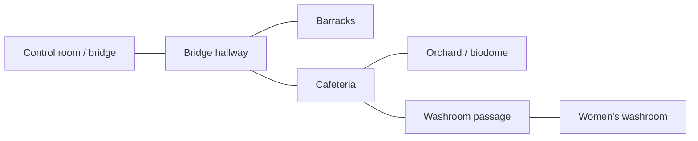

# RoomSystem: load contents by distance in the active room graph

Status: proposal only. Do not implement new components/host calls or migrate the
ship until the graph, syntax and lifetime rules have been reviewed.

## Intended behavior

One native `RoomSystem` manages an explicitly named room graph/group and
registered room agents. A room is an abstract graph vertex with persistent
identity and unloadable contents; it is not itself a spatial zone. A room may
have small doorway arrival zones, a whole-area occupancy zone, or a deliberate
combination of both. Agents, not arbitrary overlapping components, change the
current-room state.

An architectural connection is an undirected edge. `load_distance(1)` loads
the agent's current room and its immediate neighbors, using shortest-path edge
count rather than metres, visibility or floor number. Recompute the desired
loaded set when room membership or graph data changes, not in a per-room MMS
frame callback. V1 can select one registered player agent for loading while
retaining an agent identity in membership events.

From the orchard/biodome, keep the cafeteria loaded. Unload the women's washroom,
washroom passage, barracks, bridge hallway and bridge/control-room contents,
because they are more than one graph hop away. The cafeteria's stairs and upper
landing remain part of the cafeteria initially. Restaurant bays, coffee shop and
hot-dog stand remain cafeteria contents rather than extra graph vertices in v1.

A proposed initial graph is:



| Current room | Loaded at distance 1 | Examples beyond the limit |
| --- | --- | --- |
| Orchard | Orchard, cafeteria | Washroom passage, washroom, bridge hallway, barracks, bridge |
| Cafeteria | Cafeteria, orchard, bridge hallway, washroom passage | Bridge, barracks, washroom |
| Bridge hallway | Bridge hallway, bridge, barracks, cafeteria | Orchard, washrooms |
| Women's washroom | Women's washroom, washroom passage | Cafeteria, orchard, bridge, barracks |

This graph explicitly preserves the route through the cafeteria to the washrooms.
Reactor routes and any future second biodome can add their actual corridor/door
edges later; do not infer connectivity from proximity in world coordinates.
A corner alone does not have to become a separate room/hop.

## Two room-detection modes

### Doorway arrival mode

A small zone just inside a doorway reports **entering the destination room**.
The agent remains in that room after leaving the small trigger. Leaving a
threshold is not interpreted as leaving the whole room. Separate room-exit zones
are unnecessary: entering a different room replaces the current room.

A connection may have several arrival zones for a destination, for example
multiple doors into the same cafeteria. Place paired destination triggers far
enough apart that standing in a doorway does not alternate room assignments.
The native system filters by the room on the other end of the connection and
ignores repeated arrival reports for the current room.

### Whole-area occupancy mode

An open area that can be approached from any direction can use a zone enveloping
the whole area. In this mode **both enter and exit matter**:

- Enter explicitly identifies this room as the destination: the agent has entered
  that room. Add its occupancy membership and select it according to the stated
  overlap/priority rules; no doorway trigger is required.
- Exit removes this room from those memberships.
- A doorway arrival latch and a region membership are different native state;
  do not apply small-trigger exit behavior to both modes.

Each entry identifies both the room and its owning graph. Exiting the current
occupancy-mode room is a graph-exit candidate. Reconcile native room events over
the **same World update frame** before committing:

| Events for an agent in one frame | Committed result |
| --- | --- |
| Exit A, enter B in A's graph | Transition to B within the same graph |
| Exit A, enter B in a different graph | Transition directly to B and its graph |
| Exit A, no replacement room entered that frame | Leave the graph; current room and graph become null |
| Enter B on a later frame after leaving | Enter B and its graph from the outside state |

Do not retain the previous graph as active while waiting for a possible future
entry. Do not guess an adjacent room from a region exit or synthesize a return
to an earlier room from visit history. For v1, avoid ambiguous/nested occupancy
regions rather than introducing an implicit parent-room restoration policy.
A later overlapping/nested-area policy needs explicit semantics and tests.

An exit belonging to an old/non-current room must not clear a newer current
room. Multiple simultaneous destination entries need explicit priority and a
stable tie-break, independent of callback dispatch order. Preserve physical
crossing order when several boundaries are traversed during fixed substeps;
do not select a room already exited later in that same frame.

If a room uses both modes, duplicate reports of the same room are idempotent.
A fresh doorway arrival may establish a destination while its region membership
catches up in the same native update; reconcile the batch before selecting a
loaded set. Explicit whole-region exit clears that region membership, even if
an earlier doorway event announced entry into the same room. It also clears
that room's arrival latch: otherwise the latch would incorrectly keep an exited
occupancy-mode room current forever.

## Proposed MMS syntax

These APIs are **proposed, not available yet**. `RoomGraph`, `Room`, `RoomLink`
and `RoomAgent` would be ordinary components backed by native `RoomSystem`.
There is no `RoomGraph.follow`: the graph defines topology/loading policy, and
an agent separately identifies who moves through registered graphs. An agent is
not permanently bound to its initial graph; an entry zone supplies the new graph
and room. Several graphs may be registered, with one current graph per agent. No new language syntax or
replacement for `on(world, ...)` is needed.

```mms
RoomGraph.id("ship").load_distance(1) {
    // Abstract rooms; factories run only when their contents are needed.
    Room.id("bridge_hallway").contents(fn() {
        return ship_mall_entrance_hallway()
    }) {}
    Room.id("cafeteria").contents(fn() {
        return ship_mall_cafeteria()
    }) {}

    // Open-area mode: this Zone covers the whole orchard.
    // Its enter AND exit update the registered agent's room membership.
    Room.id("orchard").region(orchard_area).contents(fn() {
        return ship_park()
    }) {}

    // Doorway mode: entering a small zone announces its destination.
    // Leaving that small trigger does not mean leaving the destination room.
    RoomLink.between("bridge_hallway", "cafeteria")
        .enter("cafeteria", cafeteria_side_of_door)
        .enter("bridge_hallway", hallway_side_of_door) {}

    // Orchard entry works from any side through its whole-area region.
    // Returning to the doorway-mode cafeteria still has an arrival trigger.
    RoomLink.between("cafeteria", "orchard")
        .enter("cafeteria", cafeteria_side_of_orchard_door) {}
}

// Register the player identity, its movement target and the actual body zone.
// References are illustrative existing Transform/Zone nodes, resident globally.
RoomAgent.movement_target(player_root)
    .zone(player_capsule)
    .initial_room("ship", "bridge_hallway") {}
```

`orchard_area` is an existing whole-area Zone; `*_side_of_door` are existing small
Zones on opposite sides of a doorway. They and their transform anchors remain
resident independently of room contents. Use existing Zone shapes/frames rather
than inventing a separate spatial shape type for rooms. Multiple `.enter(room,
zone)` calls can register multiple entrances. A destination must be one of its
link's two endpoints. Optional `.priority(n)` on `Room` would resolve overlapping
occupancy regions; the exact name remains part of syntax review.

The connection declaration automatically registers graph adjacency and its
arrival triggers together. It needs no second, duplicated neighbor list. We
cannot reliably infer architectural connectivity from sensor overlap alone,
and learning edges only when the player crosses them would be too late for
preloading unvisited neighbors. An explicit connection with optional trigger
metadata is the initial design; paired named doorway metadata could generate
these declarations later without changing the graph core.

Closed doors do not remove adjacency in v1. One-way traversal and visibility
policy can be specified later; loading adjacency can remain undirected even
where movement permissions differ. A connection without triggers is valid when
whole-area regions or explicit placement identify its rooms.

The example is an interface sketch, not executable placements. Actual zones,
room transforms and bounds must be authored from the ship geometry. Room
contents inherit their authored placement; do not blindly wrap/double-apply
current offsets during migration. The factory closure is stored rather than
eagerly evaluating every room. Existing accordion deferred factories/subtree
removal can inform implementation, but loading must not depend on an accordion
or its window/chevron controls.

## Registering the moving agent

- Register a stable player/agent identity, the Transform that is the movement
  target, and the body/capsule Zone used for membership detection. A trigger hit
  must resolve to that registered agent before it can affect room loading.
- Entering a doorway with a hand, held gun, projectile, loose hot dog or an NPC
  that is not registered as the followed agent must not switch the player's room.
  Matching the body zone as well as its movement target avoids treating every
  descendant sensor as an independent agent.
- The graph does not own the camera rig. Select the appropriate agent for XR
  avatar, free XR or desktop configuration. V1 can have one active loading agent
  and multiple registered graphs. Arrival metadata selects its current graph;
  the agent remains registered when outside all graphs. Multiple-agent desired-set
  union can be added without confusing room identity with a camera component.
- Mounting keeps the same agent identity. Resolve the effective world pose/body
  probe through attachment; a temporarily disabled locomotion collider must not
  silently stop room tracking or register the truck as a second player. Specify
  how a nonblocking membership probe behaves when the physical collider is
  disabled, and cover this before vehicle migration.
- Metadata such as `RoomAgent`, initial room, links and trigger associations is
  registered before streamed factories run. First entry cannot depend on an
  unloaded destination's callback being present.
- Threshold-only rooms need an initial room on spawn; a teleport/explicit room
  placement must update the agent's room because it can bypass all doorway
  triggers. Occupancy-mode rooms may resolve a spawn/teleport using their regions.
  Do not assume entry-only triggers can recover arbitrary teleport destinations.

## Desired sets rather than a loading stack

The user's add/remove-list approach maps to set differences:

```text
desired   = rooms within load_distance of the selected current room
            (empty when the agent is outside all graphs)
load      = desired - loaded
unload    = loaded - desired
keep      = loaded intersection desired
```

If transition work is initially assembled as add/remove lists, normalize them
before executing either list:

```text
unchanged = intersection(add, remove)
add       = add - unchanged
remove    = remove - unchanged
```

A room present in both lists is removed from both lists and receives neither
operation. Keep its existing content instance and state intact: no teardown,
factory call, duplicate instance or unload/reload lifecycle callback. Deduplicate
repeated room IDs within each list as well. The direct desired/loaded set
differences above already produce disjoint work lists; this normalization makes
the same invariant explicit for incrementally assembled lists.

Load/unload work lists may be ordered for safe lifecycle operations, but loaded
membership is a set, not a LIFO stack. A shared neighbor remains loaded without
being destroyed/rebuilt during a transition. For example, orchard -> cafeteria
keeps both and adds bridge hallway/washroom passage. Transitioning back removes
only the rooms outside the orchard's neighborhood.

When an exit has no replacement entry in the same frame, compute the empty
room-desired set and remove the prior graph's unloadable contents through normal
lifecycle handling. Resident agent/entry metadata and persistent physical actors
and required collision shells are not removed. A later frame's entry can load a
new graph normally. A same-frame graph switch computes one old/new set diff;
there is no intermediate empty-set teardown.

Compare stable room identities when cancelling work, not bare display names.
An optional visit history is separate from current membership and loaded state;
it never keeps a graph active after an unmatched exit. With several loading
agents later, union their desired neighborhoods before unloading anything, so
one agent leaving does not remove another agent's required rooms.

## Native update and lifecycle

1. After physics and transform propagation, consume native arrival/region
   enter-exit changes for registered agents. Reconcile an agent's membership
   batch, initial/teleport placement and graph edits before selecting a room.
   This is one logical World update frame, not each fixed physics substep or XR
   eye render. Consume native events in that frame rather than delaying one side
   through a later MMS callback and creating an artificial unmatched exit.
2. If the frame commits a room, run bounded BFS within its graph to
   `load_distance`; if an unmatched current-room exit leaves all graphs, use an
   empty room-desired set. Graph metadata changes invalidate the cached result. Report invalid links, duplicate IDs and missing
   content factories clearly.
3. Diff desired and current room sets. Leave already loaded rooms untouched.
   Adjacent rooms should already be present before a normal doorway crossing.
4. Instantiate incoming content and retire outgoing content at a safe scene
   mutation boundary before render preparation. Batch structural invalidation;
   do not mutate a draw list while recording or release in-flight GPU resources.
5. Track per-room load generations and pending work. A load completing after the
   room is no longer wanted must not attach stale content or duplicate actors.
6. Use existing subtree/binding cleanup. Instance-owned bindings leave with their
   components. Any world-targeted binding created by contents must have explicit
   ownership/teardown using existing binding handles; do not introduce another
   `on_global_for`/`off_global` language API as a shortcut.

Initial migration should keep the shared ship input controller, player/camera
rigs, global renderer/XR settings, audio services and sky outside streamed room
contents. Settings panels are disposable views over persistent settings. Mirror
components/targets must retire safely; resident washroom trigger metadata must
resolve a newly loaded mirror rather than retain a stale handle.

Measure cold load and reload latency. Existing assets/shaders may be cached, but
recreating a factory still creates a DOM and material instances; do not promise
that reload is free or add an unbounded hidden room cache. Only stage loads
across updates if the initial measurements require it.

## Persistent state and physical actors

Graph distance is a content-loading policy, not a physics power switch.

The first safe implementation separates **resident metadata/collision shell**
from **unloadable room contents**. The streamed-out contents include visual
interiors, lights, displays, local UI and disposable fixtures. Minimal floor/wall
collision required by retained physical actors remains available. This is real
content removal, but does not mean that every collision resource is freed.
Room prefabs will need explicit separation before migration; do not invoke a
full visual prefab twice for shell and contents.

A possible additional authoring hook, to review before adding it, is:

```mms
Room.id("orchard").region(orchard_area)
    .shell(fn() { return orchard_collision_shell() })
    .contents(fn() { return orchard_visual_contents() }) {}
```

`*.shell` is a proposal, not an implemented factory/API. For the first slice,
retaining conservative architectural collision globally is acceptable if it is
measured and documented. A separate physics-streaming policy can later retain
only shells needed by active bodies and wake/support dependencies.

- Trucks, riders and player-held tools cannot be casually deleted and recreated
  with room visuals. Keep live actors under persistent ownership or explicitly
  pin their required physical environment. Switching a truck off never disables
  gravity or clears its velocity; unloading its visual room must not do so either.
- The native engine currently has no sleeping-body system. RoomSystem must not
  impersonate one or freeze distant vehicles to improve its benchmarks.
- Preserve logical state outside disposable factories: door state, ammunition,
  damaged vehicles, stock and user settings must not reset on each graph change.
  A captured MMS state object or stable actor record is preferable to serializing
  arbitrary live DOM/GPU resources. Choose persistence per prefab explicitly.
- If an actor moves across rooms while its render content is streamed out, its
  physical transform and room ownership remain authoritative when visuals return.
- Unloaded mirrors/lights and their scripts must stop work. Merely hiding visuals
  or collapsing editor/accordion controls is not sufficient evidence of unloading.

## Implementation slices after review

1. **Inventory and measurements:** define abstract rooms/groups, doorway versus
   occupancy detection, actual native agent zones/movement targets and links; record
   per-room entities, render instances, lights, mirrors, script bindings, physics
   actors and initial/reload cost. Preserve orchard baseline captures.
2. **Graph core:** pure shortest-path loaded-set calculation, stable IDs, link
   validation and current-room transitions. No content deletion yet.
3. **Native components and bindings:** `RoomGraph`, `Room`, `RoomLink`,
   `RoomAgent` plus `RoomSystem`, focused modules and deferred factories.
   Keep language/runtime changes out unless an existing capability is genuinely
   missing and reviewed.
4. **Lifecycle pilot:** load/unload two simple rooms and prove handler cleanup,
   safe pending-load cancellation and correct retained state/physical support.
5. **Ship migration:** orchard/cafeteria first, then hallway, bridge, barracks and
   washrooms. Remove redundant room-distance accordion/door gate logic only after
   the graph path passes equivalent lifecycle tests. Optional object accordions
   can remain independent local debug controls without double-owning the subtree.
6. **Compare:** orchard stationary and moving-head, identical 1920-per-eye,
   bloom/MSAA 4x conditions, with/without RoomSystem. Measure CPU/GPU/frame
   distributions, physics cost, draw/cache counts and transition spikes.

Keep implementation files focused and below repository size targets. Native
room tracking should reuse retained data and batched changes; no per-draw room
lookup, per-frame scene reconstruction or new material/pipeline per room check.

## Acceptance cases

- At orchard/radius 1, exactly orchard and cafeteria contents remain loaded;
  bridge, hallway, barracks and washroom contents are absent, not merely hidden.
- Crossing a doorway arrival zone sets its destination room once. Leaving the
  small trigger does not clear that room. Multiple entrances and duplicate events
  do not duplicate content; paired triggers do not produce boundary flicker.
- Entering a whole-area region identifies that room and graph as the destination.
  Exiting the current room with no replacement entry in that World frame clears
  both current room and graph and unloads their unneeded contents safely.
- Same-frame exit/entry within one graph or across graphs commits one transition
  and one loaded-set diff, without transient teardown of shared rooms. Dispatch
  order does not change the result. A later-frame entry works from outside.
- An old-room exit cannot clear a newer current room. Traversing several rooms
  in one frame selects the final valid destination, not an already-exited room.
- Hands, loose objects, projectiles and unrelated NPC zones cannot change the
  selected player's current room. Registered agents keep independent state.
- A room in both initially assembled add/remove lists is deleted from both work
  lists. Its existing content identity and state remain unchanged, with no load or
  unload callbacks. Duplicate entries do not execute duplicate operations.
- The add/remove set differences retain shared rooms across transitions, including
  branch/loop paths, rather than popping them simply because visitation order changed.
- Walking, XR/free-camera modes, mounting/driving, dismounting and teleporting
  select the correct room without depending on a temporarily absent avatar node.
- Dormant metadata remains queryable and graph edits update reachability.
- Repeated boundary crossings do not grow DOM, active bindings, retained mirror
  targets or duplicate NPC/vehicle instances. A stale load never reattaches itself.
- Reload retains logical ammunition/damage/settings and respects ownership of
  held objects and live physical actors.
- Off or distant physical bodies retain their required support and can receive
  supported native motion; room unload is not implemented as a gravity toggle.
- Benchmarks distinguish rendering/script savings from persistent native physics
  work and include transition/reload spikes, not only stationary means.

Related: [benchmark history](epic/vulkan-rendering-optimization/benchmark-history.md),
[native rest/wake audit](native-velocity-sleeping-and-wake.md),
[pickup power](pickup-script-power-and-continuous-physics.md),
[physics architecture](velocity-forces-and-pluggable-physics.md).

## Initial orchard evidence

The [2026-11-07 orchard report](epic/vulkan-rendering-optimization/orchard-active-physics.md)
records the unstreamed baseline at `ae55468f`: 23.216 ms stationary and 25.150 ms
moving-head with cached graphics. CPU recording is about 1 ms while scene update
is about 9 ms with native truck physics active. This proposal does not establish
that room loading alone reaches the 22 ms goal; retain that distinction in the
implementation benchmarks and measure native sleeping separately.
