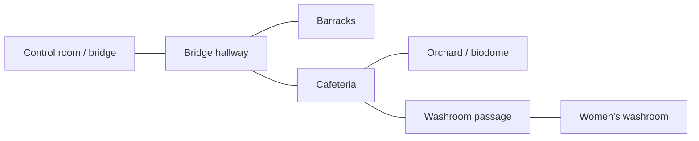

# RoomSystem: load contents by distance in the active room graph

Status: proposal only. Do not implement new components/host calls or migrate the
ship until the graph, syntax and lifetime rules have been reviewed.

## Intended behavior

One native `RoomSystem` manages one active room graph and one followed player
for the first version. A room is a graph vertex; an architectural connection is
an undirected edge. `load_distance(1)` loads the current room and its immediate
neighbors, using shortest-path edge count rather than metres, visibility or
floor number. Recompute the loaded set when the current room or graph changes,
not in a per-room/per-frame MMS callback.

From the orchard/biodome, keep the cafeteria loaded. Unload the women's washroom,
washroom passage, barracks, bridge hallway and bridge/control-room contents,
because they are more than one graph hop away. The cafeteria's stairs and upper
landing remain part of the cafeteria initially. Restaurant bays, coffee shop and
hot-dog stand remain cafeteria contents rather than extra graph vertices in v1.

A proposed initial graph is:



| Current room | Loaded at distance 1 | Examples beyond the limit |
| --- | --- | --- |
| Orchard | Orchard, cafeteria | Washroom passage, washroom, bridge hallway, barracks, bridge |
| Cafeteria | Cafeteria, orchard, bridge hallway, washroom passage | Bridge, barracks, washroom |
| Bridge hallway | Bridge hallway, bridge, barracks, cafeteria | Orchard, washrooms |
| Women's washroom | Women's washroom, washroom passage | Cafeteria, orchard, bridge, barracks |

This graph explicitly preserves the route through the cafeteria to the washrooms.
Reactor routes and any future second biodome can add their actual corridor/door
edges later; do not infer connectivity from proximity in world coordinates.
A corner alone does not have to become a separate room/hop.

## Proposed MMS syntax

The following APIs are **proposed, not available yet**. `RoomGraph`, `Room` and
`RoomLink` would be ordinary components backed by native `RoomSystem`, using
existing component/factory/event-binding mechanisms. No new language syntax or
replacement for `on(world, ...)` is needed.

```mms
// These existing Zone/Transform nodes live outside streamed content.
// Author their actual bounds from the ship geometry during migration.
let bridge_region = Zone.cube([7,2,6]).at(bridge_region_frame) {}
let hall_region = Zone.cube([2,2,5]).at(hall_region_frame) {}
let barracks_region = Zone.cube([4,2,3]).at(barracks_region_frame) {}
let cafeteria_region = Zone.cube([11,4.5,6]).at(cafeteria_region_frame) {}
let orchard_region = Zone.cube([32,4,24]).at(orchard_region_frame) {}
let passage_region = Zone.cube([2,2,4]).at(passage_region_frame) {}
let washroom_region = Zone.cube([5,3,5]).at(washroom_region_frame) {}

// Choose the active locomotion root for the configured XR/desktop rig.
// This name is illustrative; use the actual root selected by the ship flags.
let room_actor = "#ship_player_root"

RoomGraph.follow(room_actor).load_distance(1) {
    name = "ship_rooms"

    Room.id("bridge").zone(bridge_region).contents(fn() {
        return ship_control_room()
    }) {}
    Room.id("bridge_hallway").zone(hall_region).contents(fn() {
        return ship_mall_entrance_hallway()
    }) {}
    Room.id("barracks").zone(barracks_region).contents(fn() {
        return ship_barracks()
    }) {}
    Room.id("cafeteria").zone(cafeteria_region).contents(fn() {
        return ship_mall_cafeteria()
    }) {}
    Room.id("orchard").zone(orchard_region).contents(fn() {
        return ship_park()
    }) {}
    Room.id("washroom_passage").zone(passage_region).contents(fn() {
        return ship_washroom_passage()
    }) {}
    Room.id("womens_washroom").zone(washroom_region).contents(fn() {
        return ship_womens_washroom()
    }) {}

    RoomLink.between("bridge", "bridge_hallway") {}
    RoomLink.between("bridge_hallway", "barracks") {}
    RoomLink.between("bridge_hallway", "cafeteria") {}
    RoomLink.between("cafeteria", "orchard") {}
    RoomLink.between("cafeteria", "washroom_passage") {}
    RoomLink.between("washroom_passage", "womens_washroom") {}
}
```

The example shows the interface, not executable placements: the `*_region_frame`
transforms (volume centers, not floor origins) and region bounds must be authored from the real prefab extents.
Room regions, links, transforms and names remain resident independently of the
heavy contents. The factory closure is stored and invoked on load, not evaluated
while declaring every room. Migrating the actual prefab transforms must preserve
world placement; do not blindly wrap or double-apply current offsets.

Prefer this explicit graph over repeating `neighbors([...])` on both endpoints:
each connection is declared once, and links can later own door/portal metadata.
Closed doors do not change graph distance in v1; distance is architectural
adjacency. A future visibility/door policy would be a separate extension.

For code reuse, the first implementation can adapt the existing deferred factory
and subtree-removal behavior used by `ship_store_accordion`. Room loading must
not depend on rendering an accordion or querying its chevron/window controls.

## Detecting the current room

- Follow the selected active rig/locomotion root, not an arbitrary hand or a
  visible avatar mesh. XR avatar, free XR and desktop configurations need explicit
  selection. While mounted, use the followed player's effective world position;
  do not lose room tracking because the rider is attached to a truck.
- Keep room regions resident so an unloaded destination remains discoverable.
  Reuse native Zone geometry/queries and transform invalidation where suitable.
  No MMS loop polls every room each frame.
- Maintain the current room while the player occupies its region. At doorway
  overlap, prefer the previous room until the destination is unambiguous. Use a
  small spatial crossing margin or resident portal zones, not alternating loads
  on every sensor exit. Author overlap/gaps deliberately.
- If no region contains the player during a doorway gap, retain the last valid
  room rather than unload everything. Teleporting directly into another valid
  room recomputes from that room without requiring an intermediate enter event.
- Multiple graph support is deferred. V1 validates one active graph per world;
  do not silently union unrelated graphs or choose one by hash-map iteration.

## Native update and lifecycle

1. Detect a meaningful followed-pose/region or graph change after physics and
   transform propagation. Resolve the current room natively.
2. Run bounded BFS from that room to `load_distance`; graph metadata changes
   invalidate the cached result. Report invalid links, duplicate IDs and missing
   content factories clearly.
3. Diff desired and current room sets. Leave already loaded rooms untouched.
   Adjacent rooms should already be present before a normal doorway crossing.
4. Instantiate incoming content and retire outgoing content at a safe scene
   mutation boundary before render preparation. Batch structural invalidation;
   do not mutate a draw list while recording or release in-flight GPU resources.
5. Track per-room load generations and pending work. A load completing after the
   room is no longer wanted must not attach stale content or duplicate actors.
6. Use existing subtree/binding cleanup. Instance-owned bindings leave with their
   components. Any world-targeted binding created by contents must have explicit
   ownership/teardown using existing binding handles; do not introduce another
   `on_global_for`/`off_global` language API as a shortcut.

Initial migration should keep the shared ship input controller, player/camera
rigs, global renderer/XR settings, audio services and sky outside streamed room
contents. Settings panels are disposable views over persistent settings. Mirror
components/targets must retire safely; resident washroom trigger metadata must
resolve a newly loaded mirror rather than retain a stale handle.

Measure cold load and reload latency. Existing assets/shaders may be cached, but
recreating a factory still creates a DOM and material instances; do not promise
that reload is free or add an unbounded hidden room cache. Only stage loads
across updates if the initial measurements require it.

## Persistent state and physical actors

Graph distance is a content-loading policy, not a physics power switch.

The first safe implementation separates **resident metadata/collision shell**
from **unloadable room contents**. The streamed-out contents include visual
interiors, lights, displays, local UI and disposable fixtures. Minimal floor/wall
collision required by retained physical actors remains available. This is real
content removal, but does not mean that every collision resource is freed.
Room prefabs will need explicit separation before migration; do not invoke a
full visual prefab twice for shell and contents.

A possible additional authoring hook, to review before adding it, is:

```mms
Room.id("orchard").zone(orchard_region)
    .shell(fn() { return orchard_collision_shell() })
    .contents(fn() { return orchard_visual_contents() }) {}
```

`*.shell` is a proposal, not an implemented factory/API. For the first slice,
retaining conservative architectural collision globally is acceptable if it is
measured and documented. A separate physics-streaming policy can later retain
only shells needed by active bodies and wake/support dependencies.

- Trucks, riders and player-held tools cannot be casually deleted and recreated
  with room visuals. Keep live actors under persistent ownership or explicitly
  pin their required physical environment. Switching a truck off never disables
  gravity or clears its velocity; unloading its visual room must not do so either.
- The native engine currently has no sleeping-body system. RoomSystem must not
  impersonate one or freeze distant vehicles to improve its benchmarks.
- Preserve logical state outside disposable factories: door state, ammunition,
  damaged vehicles, stock and user settings must not reset on each graph change.
  A captured MMS state object or stable actor record is preferable to serializing
  arbitrary live DOM/GPU resources. Choose persistence per prefab explicitly.
- If an actor moves across rooms while its render content is streamed out, its
  physical transform and room ownership remain authoritative when visuals return.
- Unloaded mirrors/lights and their scripts must stop work. Merely hiding visuals
  or collapsing editor/accordion controls is not sufficient evidence of unloading.

## Implementation slices after review

1. **Inventory and measurements:** define actual ship room regions/links; record
   per-room entities, render instances, lights, mirrors, script bindings, physics
   actors and initial/reload cost. Preserve orchard baseline captures.
2. **Graph core:** pure shortest-path loaded-set calculation, stable IDs, link
   validation and current-room transitions. No content deletion yet.
3. **Native components and bindings:** `RoomGraph`, `Room`, `RoomLink` plus
   `RoomSystem`, focused component/binding modules and deferred factories.
   Keep language/runtime changes out unless an existing capability is genuinely
   missing and reviewed.
4. **Lifecycle pilot:** load/unload two simple rooms and prove handler cleanup,
   safe pending-load cancellation and correct retained state/physical support.
5. **Ship migration:** orchard/cafeteria first, then hallway, bridge, barracks and
   washrooms. Remove redundant room-distance accordion/door gate logic only after
   the graph path passes equivalent lifecycle tests. Optional object accordions
   can remain independent local debug controls without double-owning the subtree.
6. **Compare:** orchard stationary and moving-head, identical 1920-per-eye,
   bloom/MSAA 4x conditions, with/without RoomSystem. Measure CPU/GPU/frame
   distributions, physics cost, draw/cache counts and transition spikes.

Keep implementation files focused and below repository size targets. Native
room tracking should reuse retained data and batched changes; no per-draw room
lookup, per-frame scene reconstruction or new material/pipeline per room check.

## Acceptance cases

- At orchard/radius 1, exactly orchard and cafeteria contents remain loaded;
  bridge, hallway, barracks and washroom contents are absent, not merely hidden.
- Crossing orchard/cafeteria preloads the next room and changes the neighbor set
  once; lingering in overlapping doorway zones causes no load/unload flicker.
- Walking, XR/free-camera modes, mounting/driving, dismounting and teleporting
  select the correct room without depending on a temporarily absent avatar node.
- Dormant metadata remains queryable and graph edits update reachability.
- Repeated boundary crossings do not grow DOM, active bindings, retained mirror
  targets or duplicate NPC/vehicle instances. A stale load never reattaches itself.
- Reload retains logical ammunition/damage/settings and respects ownership of
  held objects and live physical actors.
- Off or distant physical bodies retain their required support and can receive
  supported native motion; room unload is not implemented as a gravity toggle.
- Benchmarks distinguish rendering/script savings from persistent native physics
  work and include transition/reload spikes, not only stationary means.

Related: [benchmark history](epic/vulkan-rendering-optimization/benchmark-history.md),
[native rest/wake audit](native-velocity-sleeping-and-wake.md),
[pickup power](pickup-script-power-and-continuous-physics.md),
[physics architecture](velocity-forces-and-pluggable-physics.md).

## Initial orchard evidence

The [2026-11-07 orchard report](epic/vulkan-rendering-optimization/orchard-active-physics.md)
records the unstreamed baseline at `ae55468f`: 23.216 ms stationary and 25.150 ms
moving-head with cached graphics. CPU recording is about 1 ms while scene update
is about 9 ms with native truck physics active. This proposal does not establish
that room loading alone reaches the 22 ms goal; retain that distinction in the
implementation benchmarks and measure native sleeping separately.
