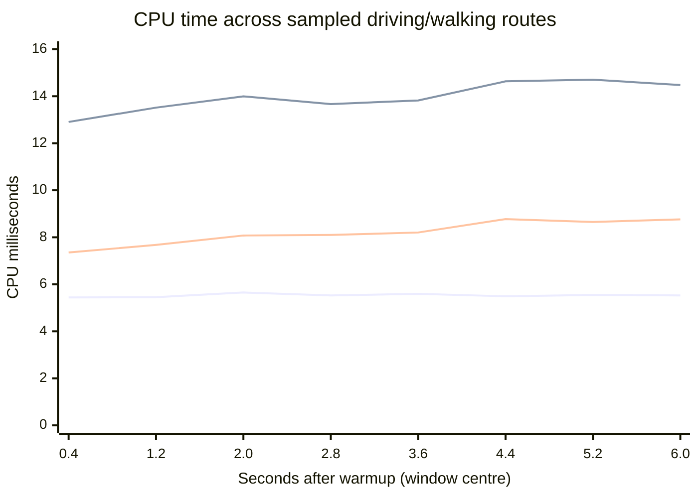

# Ship cafeteria: driving CPU attribution

The primary event-selection proposal now lives in
[Host-filtered bespoke MMS event handlers](../../crates/meow-meow-script/docs/spec/host_filtered_bespoke_mms_event_handlers.mms).
Its preferred form uses a typed selector such as `DataEvent { name = "GraphicsSettingsChanged" }`
as parameter two of `on`; it remains a proposal, not an implemented fix.

Baseline checkpoint: `c11264f8` (committed before this investigation). Profiling
changes are separate. This report uses the ignored local ship example: Mitten,
Miku, one cafeteria pickup, no orchard; bridge/barracks/washrooms remain loaded
and the mirror remains disabled. Truck Anime and character directional-fill
materials are present in both fresh captures.

## Conditions

GTX 1080, offscreen stereo 1920 x 1920 per eye, bloom/emission on, MSAA 4x.
240 warmup / 480 sample frames each, walking then driving in fresh processes.
The longer host-call capture uses 1,200 samples after the same warmup. No live
demo was listed by `nvidia-smi` before each launcher ran. No build or other
benchmark ran concurrently. Simulation uses 1/75 s updates; native velocity
uses 120 Hz fixed substeps. This is not a live ALVR/compositor FPS measurement.

Timers and counters are opt-in with `SHIP_PROFILE_UPDATE_TIMINGS=1` in the
existing test fixture. Frame samples are buffered and written after timing;
there is no file logging in timed stages. The instrumentation is `cfg(test)`
and disappears from production builds.

## Temporal behavior

The older Anime-truck driving capture rises from 12.939 ms in its first 120
samples to 14.207 ms in its last 120, so a strictly constant-cost model is
incomplete. The pattern repeats across several material/view controls.

Fresh per-stage measurements show both sustained overhead and a growing
callback cost. Means below use successive 60-frame windows (0.8 synthetic
seconds each), starting after warmup. Series order: walking update, driving
update, driving callback service.

| Window | Walking update | Driving update | Driving callback service |
| --- | ---: | ---: | ---: |
| 1 | 5.442 | 12.907 | 7.353 |
| 2 | 5.452 | 13.516 | 7.676 |
| 3 | 5.653 | 13.996 | 8.076 |
| 4 | 5.527 | 13.668 | 8.100 |
| 5 | 5.594 | 13.822 | 8.204 |
| 6 | 5.490 | 14.634 | 8.774 |
| 7 | 5.549 | 14.705 | 8.652 |
| 8 | 5.526 | 14.477 | 8.761 |

There is also an expected one/two-physics-substep timing band: at 75 Hz,
120 Hz physics averages 1.6 substeps/update. Walking averages 4.820 ms for
one substep and 6.002 ms for two; driving averages 13.270/14.429 ms. The
additional driving cost exists in both bands. Do not mistake this cadence
for a new handler or room loading/unloading.

## First attribution

| CPU stage | Walking mean | Driving mean |
| --- | ---: | ---: |
| Whole update | 5.529 ms | 13.966 ms |
| Native system tick (inclusive) | 5.526 ms | 5.744 ms |
| MMS callback servicing | 0.001 ms | 8.200 ms |
| Final command processing | 0.001 ms | 0.020 ms |

Almost all of the extra ~8 ms is at the MMS callback-service boundary.
Native tick grows about 0.219 ms in these captures, rather than 8 ms.
That does not imply the vehicle's arithmetic itself is expensive: callback
setup, interpreter work, host queries and native methods are initially inclusive.

The native breakdown includes velocity integration/flush/contact, XR, avatar IK,
secondary motion and render publication. Physics remains active; the profiler
does not park or freeze the truck. Existing input/frame event bypass behavior
for powered-off/unoccupied vehicles is unchanged.

## Host-call attribution and longer capture

In 1,200 driving samples, callback invocation averages 8.563 ms, while host
lease entry/exit together cost about 0.001 ms. Nested native host query time is
0.789 ms; handle validation 0.019 ms; native component methods 0.014 ms. Most
time is still outside those host operations, in callback invocation/evaluation
and related runtime work. Do not add these nested times to callback totals.

The world component count remains exactly 14,102. Average workload stays near
7.05 queued callbacks, 1.01 queries (the pickup query), 8.09 validation requests
covering about 213 handles, and 5.08 native method calls per update. There is
no increasing DOM count or rising callback/query count in this capture.

Callback-invocation means over successive 120-frame windows rise from
7.346 to 9.494 ms across 16 synthetic seconds; host query time changes only
0.753 -> 0.827 ms. Native handle validation stays near 0.02 ms. Further
instrumentation records individual callback identities/event labels and timings
to identify the handlers and remaining runtime cost.

## Artifacts and implementation

Raw summaries, full frame logs and GPU process snapshots remain ignored under
`examples/local/benchmarks/`:

- `cafeteria-1920-walking-cpu-drill2-r1-2026-11-07`
- `cafeteria-1920-driving-cpu-drill2-r1-2026-11-07`
- `cafeteria-1920-driving-cpu-host-drill-r1-2026-11-07`

Each capture has `.json`, `.frames.json` and `.log` files. Historical captures
are retained; the [benchmark ledger](epic/vulkan-rendering-optimization/benchmark-history.md)
links this report.

To keep instrumentation out of oversized files, the existing direct system
update sequence was moved to `system_world_update.rs` and the callback-service
method to `runtime_callback_delivery.rs`. This preserves call order, batching
and ownership, without new production dispatch or a new MMS API.

## Individual callbacks and settings-listener control

Per-callback timings reconcile the callback budget in a separate 480-frame
capture:

| Callback | Calls/frame | Inclusive CPU ms/frame |
| --- | ---: | ---: |
| Vehicle world FrameTick | 1.000 | 4.812 |
| Global graphics-settings DataEvent listener | 3.025 | 1.812 |
| Global XR-settings DataEvent listener | 3.025 | 1.267 |
| Vehicle XrAxisChanged | 0.008 | 0.039 |

Both global DataEvent registrations have native scope `None`. In the active
scene, the two global listeners are in `graphics_settings_panel.mms` and
`xr_settings_panel.mms`; they test strings inside MMS for GraphicsSettingsChanged
and XrSettingsChanged. Velocity reset and both translate commands emit generic
VelocityChanged data events. Angular velocity does not emit that event. The
per-frame heading refresh therefore wakes each unrelated settings listener three
times; at throttle reversals there are additional command/event callbacks.

A diagnostic native bypass of only those two binding IDs keeps panel geometry,
truck control, native physics and every sampled truck/player pose and camera
matrix identical. A fresh full/bypassed pair measures:

| CPU measurement | Full listeners | Settings listeners bypassed |
| --- | ---: | ---: |
| Whole update | 13.972 ms | 10.962 ms |
| Native system tick | 5.797 ms | 5.771 ms |
| MMS callback service | 8.154 ms | 5.173 ms |

VelocityChanged deliveries to script callbacks fall from 6.05/frame to zero.
This independently confirms roughly **3 ms/frame** of unnecessary settings
callback work. The payload guard prevents UI updates, but cannot avoid callback
entry/evaluation. Changing the listener name would not fix this: `name` is a
handler-routing label, not a DataEvent payload predicate. Native payload filtering,
narrow settings signals or a dedicated settings event source should deliver only
relevant changes. Production event semantics are deliberately unchanged here.

The remaining ~5 ms frame handler contains ordinary runtime evaluation plus
about 0.7–0.8 ms in the live pickup query. Its inner interpreter/preparation costs
are not yet separately timed. Source inspection suggests environment/function
cloning as an investigation target, not an established attribution. The
observed per-call growth remains unexplained; stable callback/query/component
counts rule out a simple increase in those counts, not every possible retained
heap or runtime-cache issue.

An additional attempt bypassing the vehicle FrameTick handler failed the
fixture's meaningful-motion assertion. It is **excluded**, since it did not
retain a valid moving-truck workload. Do not quote its time as a driving speedup
or conclude that disabling the handler preserves vehicle behavior.

Additional raw stems under the same ignored folder:

- `cafeteria-1920-driving-cpu-callback-drill-r1-2026-11-07`
- `cafeteria-1920-driving-cpu-baseline-r1-2026-11-07`
- `cafeteria-1920-driving-cpu-settings-bypassed-r1-2026-11-07`

The invalid `cpu-frame-bypassed-r1` log is retained and marked excluded.
`SHIP_PROFILE_BYPASS_CALLBACKS` is a test-only comma-separated list of native
binding IDs; these opaque IDs are capture-specific, not an authoring API. The
launchers assert each binding exists. Native bypass was diagnostic only; no
settings callbacks were removed from production assets.

## Verification

The retained-session install/replace/close test, fresh-host callback service test
and avatar-stage command-order regression test pass after extraction/instrumentation.
The paired Vulkan fixtures pass movement, mounting, power, resident room and
frozen-mirror checks. Per-sample native physics substep counts remain recorded.

## Independent runtime optimization: shared immutable function bodies

Typed table/record values with host-meaningful identity are now a confirmed
direction in the primary spec, but are not a prerequisite for improving callback
execution. No selector syntax, filter or subscription behavior changed here.

A userspace `perf` sample attached after the warmup marker showed substantial
AST expression cloning/dropping and associated allocation work. Optimized stack
unwinding was partial, so it identifies an investigation target rather than a
complete partition of CPU time. Do not use the sampled run as a clean frame-time
benchmark; profiling overhead was present. Its raw sampling data/reports remain
ignored under `cafeteria-driving-cpu-vm-sampling-2026-11-07.*`.

Runtime function values previously owned their `BlockStatement` bodies. Cloning
a callback, a function lookup or captured environment could therefore deep-copy
immutable executable ASTs repeatedly. Runtime `Value::Function.body` now uses
`Arc<BlockStatement>`; construction copies/materializes the code once and later
function-value copies share it. Captured bindings/argument frames remain governed
by the existing semantics. The legacy adapter makes an owned AST copy only when
converting a function across that older boundary. Parser AST representation and
transform passes are unchanged.

The 480-sample post-change captures retain every handler, including both broad
settings listeners. There are NO diagnostic bypasses. Same scene/materials,
1920/eye, MSAA 4x, bloom/emission, 240 warmup, all background rooms loaded, mirror
off, native truck physics active:

| Measurement | Earlier full driving control | Shared code, driving | Shared code, walking |
| --- | ---: | ---: | ---: |
| CPU update | 13.972 ms | 6.575 ms | 5.485 ms |
| Native system tick | 5.797 ms | 5.671 ms | 5.481 ms |
| MMS callback service | 8.154 ms | 0.890 ms | 0.001 ms |
| GPU graphics, both eyes | 12.937 ms | 12.339 ms | 11.169 ms |
| Elapsed stereo frame | 28.351 ms | 20.164 ms | 17.845 ms |
| Elapsed p95 | 30.167 ms | 21.886 ms | 19.867 ms |

Both modes retain all original pass draw counts. Every sampled driving player/
truck pose and camera matrix matches the earlier full-listener control exactly.
Callback counts remain 7.058/frame, including 6.05 VelocityChanged deliveries;
this is not a result obtained by skipping input, UI listeners, motion or rendering.
Per-callback costs are now 0.765 ms/frame for FrameTick and 0.117 ms/frame for
both settings listeners combined (versus 4.812/3.079 ms in the earlier callback
trace). Exact changes in native query/GPU timings include run/cache variation;
those algorithms and shaders were not optimized by this change.

A separate 1,200-sample driving capture checks the earlier temporal drift over
16 synthetic seconds: CPU update averages 6.567 ms, callback service 0.885 ms.
Successive 120-frame callback windows are:

    0.877, 0.880, 0.904, 0.884, 0.908, 0.890, 0.874, 0.875, 0.876, 0.878 ms

The previous upward trend is absent in this longer capture. This does not prove
a general absence of leaks/long-session drift. Mean elapsed frame is 19.885 ms,
p95 21.444 ms, GPU graphics 12.073 ms, with every callback still enabled.
The short and long driving captures meet the offscreen 22 ms goal; sustained
live XR/ALVR and the tracked/full ship remain separate validation workloads.

All 88 MMS crate tests and both engine retained-session facade tests pass.
Shared immutable bodies improve runtime work for existing vehicle and settings
code without waiting for typed records. Broad DataEvent delivery remains an
architectural/selectivity issue; after this fix it no longer costs the old
3 ms/frame. Do not count that historical saving again as a future expected gain.

New raw capture stems (ignored local folder):

- `cafeteria-1920-walking-cpu-shared-function-body-r1-2026-11-07`
- `cafeteria-1920-driving-cpu-shared-function-body-r1-2026-11-07`
- `cafeteria-1920-driving-cpu-shared-function-body-long-r1-2026-11-07`

Each has summary/frame/log files; source hashes and test logs are preserved with
`shared-function-body-manifest-2026-11-07.json`. These are new measurements;
earlier timings and invalid-control exclusions remain unchanged.
