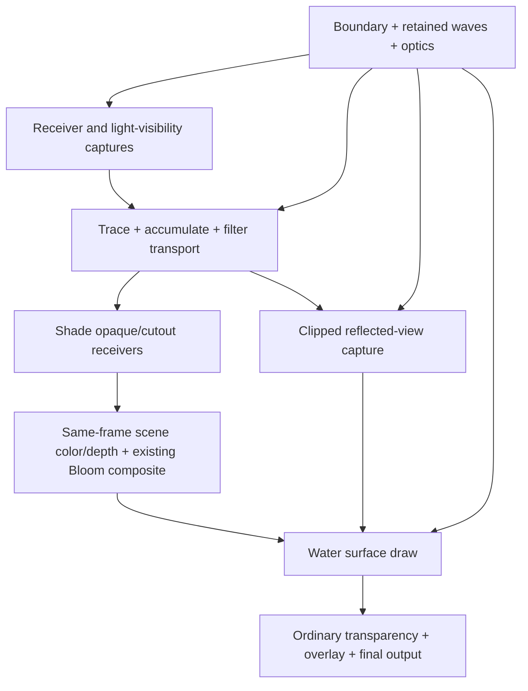

# Task: water surface optics and refracted lighting

Date: 2026-10-13
Updated: 2026-10-14 — reuse Zone for the water domain and initialization-time candidate discovery.
Status: proposed; documentation only. No renderer implementation in this task.
Architecture: [Materials v3 / custom materials](epic/custom-materials.md),
[stable instances and family contracts](material-instances-and-family-contracts.md),
and [resolved material contract](material-component-and-resolved-contract.md).

## Outcome and the two slices

1. A water surface combines partial reflection, direct-light specular highlights,
   and a view of submerged geometry distorted by the surface normal.
2. Light crossing that surface bends and illuminates other geometry, including
   the concentrations of light called caustics. Receivers keep ordinary lit
   materials; shared renderer lighting supplies the transported contribution.

These describe different paths through the same boundary:

```text
surface appearance: camera -> water boundary -> reflected/refracted scene
receiver lighting:  light -> water boundary -> opaque receiver -> camera
```

Changing the camera lookup cannot change the illumination already computed on
the floor. Conversely, caustics should remain attached to world geometry as the
camera moves. Transmission describes light crossing the interface; refraction
changes its direction; caustics describe focusing or spreading of that light.
The receiver is generally opaque and need not itself transmit anything.

## Materials v3 lookup and implementation status

There is no separately named `materials-v3.md` in this checkout. Git history
identifies the current proposal: commit `bac0d61f` ("update materials v3
proposal") updates `epic/custom-materials.md`,
`material-component-and-resolved-contract.md`, and
`material-instances-and-family-contracts.md`. Commit `36d7f13f` likewise calls
the LED example preparation "materials v3". Those documents are the current
plan; [Materials v2](epic/materials-v2.md) supplies earlier architecture and
records the newer public `Material` direction at its top.

Source inspection on this date confirms the large refactor is still pending:

| Area | Present implementation | Implication for water |
| --- | --- | --- |
| Material identity | [primitives.rs](../../src/engine/graphics/primitives.rs) has fixed `MaterialHandle` values and a `Material` containing static shader paths. | No generic family/definition/mutable-instance registry yet. |
| Shading authoring | [anime_shading.rs](../../src/engine/ecs/component/anime_shading.rs) selects Anime or Toon. Anime settings flow to visual instances and value-keyed descriptors. | A prototype for the stable-instance bridge, rather than completed v3. |
| Transmission | [refraction-mesh.frag](../../assets/shaders/refraction-mesh.frag) samples scene color/depth with an IOR/strength/effective-thickness offset and foreground rejection. | Reusable capture machinery; no reflection, light-dependent specular, physical water path length, or receiver illumination. |
| Desktop resources | [vulkano_renderer.rs](../../src/engine/graphics/vulkano_renderer.rs) prepares snapshots only with active post-processing; rough transmission also has pipelines and a conditional filtered pyramid. | The refraction spec's claim that rough rendering is absent is stale. Source and the transmission epic are more current on that point. |
| Other views | Mirror captures pass no transmission snapshot; per-eye transmission integration remains pending. | Do not assume existing desktop refraction works in XR or water reflections. |
| Mirrors | [MirrorSystem](../../src/engine/ecs/system/mirror_system.rs) and the renderer produce mono/stereo planar captures. [Mirror status](mirror-render-pass-status.md) records disabled oblique clipping and missing viewer-visibility gating. | Reuse capture infrastructure after proving water-plane clipping; a Mirror component currently replaces surface shading. |
| Lighting | [Toon](../../assets/shaders/toon-mesh.frag) and [Anime](../../assets/shaders/anime-mesh.frag) evaluate point, directional, and spot lights directly. | No occlusion/caustic map sampling in those light loops. Water transport needs new lighting infrastructure. |
| Spatial queries | [BvhSystem](../../src/engine/ecs/system/bvh_system.rs) indexes renderable AABBs gated by `Raycastable`. | This is not an all-scene GPU triangle acceleration structure for photon tracing. |
| Zones | [ZoneComponent](../../src/engine/ecs/component/zone.rs) defines transformed non-physical regions; [zone_query](../../src/engine/ecs/system/zone_query.rs) implements point classification, zone-pair overlap and enabled-zone subtree discovery. | Reuse a box Zone for the water volume. Enumerating arbitrary renderables overlapping it needs a bounds-query adapter; the current API does not provide that operation. |

This is a source/design audit, not runtime visual or GPU validation.

## How water fits v3

Keep material state, spatial boundaries, and renderer work distinct. Names below
describe responsibilities; they are not committed Rust or MMS APIs.

| Owner | Responsibility |
| --- | --- |
| Material family/definition | Surface interface, supported geometry/state, optical input schema, supported capture/transport programs, and declared renderer capabilities. |
| Material instance | Stable shared optical values: IOR, absorption, roughness, wave controls/time binding. Updates use v3's retained revisions and bounded frame-safe storage. |
| Water body / boundary record | Spatial occurrence: mean surface plane, reference to an existing Zone defining the submerged volume, material-instance reference, coherent wave-field reference, and cached geometry candidates. |
| Renderable instance | Mesh/transform, coverage and supported per-renderable inputs; resolved material binding. |
| Renderer | Per-view scene snapshots/reflection captures; per-body/per-light transport maps, visibility, synchronization, quality budgets, and retirement. |
| Receiving material family | Declared support for transported lighting, with built-in Toon/Anime adapters. Unlit/custom programs require explicit semantics. |

One shared material can style two pools while each pool has its own boundary and
capture/transport resources. Thus resource identity includes spatial occurrence
and view/light as appropriate, not just `MaterialInstanceId`. Sharing a material
must not merge the pools' transforms, receiver domains, or reflection cameras.
Use v3's existing wrapper/reference/attachment contracts; do not require general
multi-parent spatial subtrees to make one pool work.

Declare these capabilities separately: sample scene color/depth, consume planar
reflection, produce refracted illumination, and receive transported lighting.
Reading IOR or scene color alone does not authorize a caustics pass. A custom
camera-facing fragment cannot automatically be evaluated from a light's view:
transport needs an explicit reusable interface/wave evaluation contract.

This follows v3's emission precedent: consuming a field, providing a compatible
pass implementation, and activating renderer work are different decisions.
Initially register supported built-in water and lit-receiver programs. Arbitrary
custom fragment programs do not acquire lighting integration by declaration alone.

The [opaque f32 time-animation milestone](material-f32-time-animation-first-slice.md)
stays first. Water is a subsequent capability consumer, not another 0.10.0
completion requirement. Renderer-owned textures do not need public arbitrary
texture inputs, but they do need validated descriptors/pass contracts. Richer
authored values follow v3's schema plan; do not disguise resource handles as f32s.

## Shared boundary and wave contract

Start with one finite, horizontal water surface and bounded depth, viewed from
air. A plane alone says where an interface is, but cannot identify a finite lake,
which side contains water, how far water extends, or when a ray exits it.
Use an existing rectangular `Zone` to describe the submerged region and derive
the first surface's footprint from its top face. Optical meaning belongs to the
water consumer; the Zone remains a reusable, non-physical region. Discover
geometry overlapping that region, rather than naming the floor material.

### Zone discovery at initialization

Seed a per-water-body candidate list with a synchronous zone/bounds query once
scene construction, generated geometry registration, transforms and bounds are
ready. For a fully static scene with a fixed water zone, that initial result can
remain cached. This avoids rediscovering the world for each transport pass.

Use conservative **overlap**, including boundary contact, rather than checking
only object origins or requiring full containment. A floor may touch the box's
bottom face; a large terrain mesh or partly submerged prop can intersect the
water even when its origin is outside. Keep those renderables as candidates;
clip/test their actual surface samples against the water domain later.

The existing `overlap_zones` accepts two authored Zones, while `classify_point`
classifies one point. Neither directly returns all rendered geometry in a box.
Add a small renderable-bounds query adapter using the existing resolved Zone
frame and shared intersection geometry. Ordinary renderables should not need
an authored Zone, `Collidable`, or `Raycastable` merely to receive water lighting.
Begin with one scoped initialization scan and cache its results; an all-renderable
spatial index is a measured optimization, not a prerequisite for this proof.

For a changing scene, update membership on spawn/removal, transform or bounds
changes, generated mesh changes, and water-zone shape/frame/enabled changes.
Retest changed objects even if they were previously outside the candidate list;
a zone change can require refreshing the whole scoped list. A moving object
still inside the zone retains membership but invalidates captured geometry.
Wave/light changes invalidate transport without requiring another membership
query when conservative domain bounds are unchanged.

Do not depend on current `ZoneEntered`/`ZoneExited` observation for arbitrary
renderables: [the observer](zone-observer-candidate-filtering-and-broad-phase.md)
currently considers eligible slide collidables, excluding static/passive and
mounted participants. Water needs a non-physical rendering consumer with its
own candidate/update contract. Static initialization caching can be the first
stage; dynamic support must satisfy the movable-prop gate below.

The Zone query answers which geometry might be affected. Receiver depth capture
and refracted intersection then determine where light actually lands on that
geometry. Both steps are needed; membership alone does not provide a ray hit,
surface normal, visibility or focusing. Above-water shadow blockers are queried
in a separate conservative region along the incoming light path, since they
can occlude water without overlapping its submerged Zone.

Use one deterministic height/slope field in surface coordinates, e.g. analytic
waves with retained time and coefficients. Surface shading and light transport
evaluate the same normal and material revision. For the first small-wave proof,
keep the geometric interface flat and use slope normals in both slices; record
this approximation. Large displacement later changes geometry, bounds, clipping,
and ray/interface intersections together. View-specific normal tricks are not
suitable as the transport normal field.

## Slice 1: water surface appearance

### Rendering and optical model

Use a dedicated water surface definition with compatible mesh vertex selection;
do not stack the current Mirror and Refraction material selections on one draw.
The renderer binds both resources to the water program:

- Same-frame scene color plus matching depth for the current view. Begin with
  the existing bounded screen-space refraction approximation and foreground
  rejection; capture includes submerged surfaces after their lighting is shaded.
- Planar reflection capture of the scene above the mean water plane, excluding
  the source water surface and clipping geometry on the submerged side. Waves
  perturb lookup coordinates; the reflected camera remains based on the mean
  plane. Strong waves need a later reflection model.
- Scene lights and a coherent wave normal for analytic specular highlights.
  Surface roughness controls the specular lobe. Blurring a transmitted image is
  a separate operation from roughening reflection/specular.

Partition reflection/transmission using angle-dependent dielectric Fresnel.
Use the same IOR for camera and light paths, with explicit entering/leaving
orientation. A dark underwater object may still be visible through water because
scene-color transmission and its lighting are separate inputs.

Direct-light highlights account for reflected radiance from analytic lights;
the capture provides reflected scene radiance. Define a single contribution
policy for any source represented in both (for example a visible emissive sun),
so it is not counted twice. A stylized lobe is acceptable if its energy/control
semantics and Fresnel relationship are stated.

Keep raster coverage separate from optical transmission: full water coverage
can write alpha 1 while its RGB already contains the refracted background. An
additional generic opacity blend would mix that background a second time.
Choose and document the compositing equation before tuning appearance. Initially
retain the dedicated transmissive phase's depth test and depth-write-off policy;
arbitrary intersecting/overlapping transparent surfaces remain unsupported.

Camera-to-bottom thickness needs linearized/reconstructed depth and a valid
refracted hit estimate, not subtraction of nonlinear device depths. The current
effective `thickness` is a distortion control. Until physical path length is
available, label tint/distortion as approximations. Absorption later uses
`T_rgb = exp(-absorption_rgb * distance_in_water)`; tint is not absorption.

### Work and gate

- [ ] Register the water definition/capabilities through v3; declare inputs,
  state, supported geometry, and descriptors without another handle cross-product.
- [ ] Prove reflection clipping/projection using the existing mirror machinery;
  validate objects crossing the plane and close/grazing viewpoints.
- [ ] Generalize transmission snapshots to required desktop paths, including
  post-processing disabled; use independent eye-local resources for XR.
- [ ] Bind reflection and transmission to one shader; add Fresnel and
  light-dependent highlights using the shared wave field.
- [ ] Define color space, coverage/blending, depth rejection and edge fallbacks;
  preserve Bloom inclusion once and document capture/transparency limitations.
- [ ] Show an above-water object in reflection, submerged checkerboard
  distortion, and a highlight that moves when the light moves. Camera angle
  changes reflection weight; setting wave slope to zero removes wave distortion.
- [ ] Measure draw/capture counts, GPU time and image bytes for desktop and XR;
  validate resize, supported MSAA, frames in flight, and source removal.

Gate: all three requested surface effects work together in a documented view
matrix, with stable material identity and bounded resources during animation.
Surface-only water can ship before receiver lighting; state that limitation.

## Slice 2: refracted light reaching ordinary surfaces

### Automatic discovery and method selection

Receiver membership is geometric: a valid light path crosses the finite water
boundary and reaches a surface before leaving the supported medium domain.
"Below the plane" or an object's origin is insufficient. Geometry can straddle
the surface, block a ray, or be below a different pool.

| Method | Receiver information | Fit for an initial slice |
| --- | --- | --- |
| Scrolling projected texture | Surface position plus domain mask | Useful art effect; not derived from actual normals/light paths. |
| Photon mapping to an analytic floor | Known plane intersection | Good optical diagnostic; cannot fulfill automatic arbitrary receiver discovery. |
| Photon tracing against a bounded receiver depth field | GPU capture of the first submerged surface in a fixed projection | Recommended first automatic proof, with an explicit single-layer geometry limit. |
| Tracing in the camera depth buffer | Only surfaces visible to that eye | Limited off-screen/hidden geometry; eye-dependent generation. |
| GPU triangle ray tracing / richer scene representation | Actual supported scene intersections | Better geometry coverage; a larger acceleration/lifecycle project. |

The recommended depth-field method is our proposed raster implementation, not
an existing engine capability. Its first proof supports floors, slopes, and the
exposed tops of submerged objects representable in a top-down depth field.
Vertical walls, overhangs, hidden lower layers, and arbitrary geometry require a
richer representation. Unsupported rays must miss rather than illuminate a
different hidden surface. A plane fixture is a debug stage, not the final gate.

### Proposed bounded generation path

Start with one selected directional light, one bounded body, and small slopes.
Reuse renderer draw geometry/coverage in new auxiliary captures; ordinary objects
participate without `Raycastable` or a special receiver material assignment.
The cached Zone-overlap candidates supply the submerged capture draw list;
the incoming-light region supplies above-water occluder candidates.

1. Capture receiver depth, geometric normal, and surface identity in the body's
   top-down projection, clipping to submerged geometry in the supported domain.
   Include opaque blockers even if their material does not receive lighting;
   use actual cutout coverage. Static and animated geometry must use compatible
   capture vertex programs or explicitly report unsupported cases.
2. Establish visibility from the light to sampled water entry points with a
   bounded light-space occluder-depth capture. This is new work: existing light
   shaders do not already supply shadow maps. Exclude the water boundary from
   blocking itself and account for above-water geometry.
3. Sample the boundary over a fixed grid. Evaluate the shared normal and refract
   the light's incident propagation direction using `eta = n_air / n_water`.
   Trace each ray through the receiver depth field using bounded marching and
   intersection refinement. Retain first-hit position, normal/identity, and
   traveled water distance. Domain exits and unresolved intersections contribute
   nothing; overlapping bodies and side-exit refraction are later work.
4. Assign flux per boundary sample using incident light, represented source
   area, entry cosine, visibility, Fresnel transmission and water absorption.
   Splat normalized finite footprints at valid hits into a linear HDR transport
   atlas. Converging samples concentrate energy; spreading samples reduce it.
   Bound footprint size and concentration to avoid singular spikes. Resolution
   changes must not multiply total delivered light.
5. Make filtering and receiver lookup validate depth, normal and surface
   identity. A 2D atlas without these tests would paint hidden geometry beneath
   a hit, cross discontinuities, and leak between objects. Store surface
   irradiance for the initial diffuse receivers, accounting for actual receiver
   area and incoming direction during deposition; do not apply a second cosine
   during shading. Directional transport for glossy receivers is later work.

Light-view photon generation and separate gathering are established caustic
techniques; see [Wyman and Davis's image-space caustics paper](https://cwyman.org/papers/i3d06_imgSpaceCaustics.pdf).
That paper also discusses storing arrival direction and attenuated intensity.
The bounded top-down receiver field above is our implementation choice.

Finite photon footprints need area-dependent weighting rather than treating
each hit as an equally bright pixel. NVIDIA's
[water-caustics workflow](https://developer.nvidia.com/blog/generating-ray-traced-caustic-effects-in-unreal-engine-4-part-2/)
describes recording water positions/normals, tracing refracted rays, and
estimating footprints from adjacent rays. Its ray-traced hit stage is a useful
future option; adopting it here would require a new GPU scene representation.

### Receiver shading and avoiding double illumination

Add transport sampling to the supported shared lighting contract, with built-in
Toon and Anime implementations. The author continues assigning the same material
to the floor, rocks, and props. Eligibility is a material-family capability;
actual influence is determined per surface sample and light path.

For the selected light, use conceptually:

```text
selected_light_contribution = unaffected_direct + transported_water_light
```

The part of direct illumination whose path crosses the water is replaced by
transport, rather than left intact underneath an additive bright pattern.
Coverage must be determined independently of whether a photon splat exists:
regions where light spreads out, is absorbed, or is occluded should darken.
An auxiliary direct-path visibility/domain test must also keep above-water
blockers from leaving the old unshadowed direct term visible in this region.
Other lights and ambient retain their existing behavior initially. Label those
as unrefracted approximations; ambient is not a directional photon source.

Toon needs an explicit policy for inserting the transported light before its
quantization. Anime currently uses light amount to choose an albedo ramp and
does not accumulate colored direct radiance like Toon; decide how colored
transport affects that model and how bright caustics survive its albedo ceiling.
Record a stylized response rather than silently assuming a PBR irradiance map
will look correct in both shaders. Unlit should remain unlit. A custom material
must implement the receiver contract to consume transport; no universal
post-process add can recover its BRDF, albedo, or intended lighting semantics.

### Work and gate

- [ ] Reference a rectangular Zone as the water domain; seed overlapping
  renderable candidates after scene initialization and geometry/bounds readiness.
  Verify static caching, boundary-touching floors and partially submerged meshes.
- [ ] Specify the bounds-query adapter and membership/capture invalidation for
  object or zone changes, including objects entering from outside the cached set.
- [ ] Freeze domain, selected-light semantics, capture formats, receiver lookup,
  visibility, replacement mask, and normalized flux/footprint contract.
- [ ] Prove refraction against an analytic floor, then replace that fixture's
  intersection with the supported automatic depth-field capture/tracing path.
- [ ] Add a sloped floor and submerged movable prop with ordinary materials.
  Move/remove them and verify generated illumination follows updated geometry.
- [ ] Add an above-water occluder and a submerged opaque obstruction; verify
  blocked samples do not light the floor and splats do not leak across identities.
- [ ] Verify flat water gives broadly uniform transmitted light on a flat
  receiver, waves redistribute it, light direction changes the pattern, and
  stronger absorption/depth reduces delivered flux. Compare total flux at two
  sampling resolutions within a stated approximation tolerance.
- [ ] Prove camera motion and two XR eyes see the same world-space pattern;
  retain transport when the surface is off-screen but an affected receiver is visible.
- [ ] Validate partial submersion, footprint boundaries, non-receiving blockers,
  dark defocused regions, and no duplicate selected-light contribution.
- [ ] Measure generation, filtering, lookup and capture cost, memory, update
  cadence and bounded allocations. Document rejected geometry/light modes.

Gate: ordinary supported receivers are found automatically, transported light
depends on the real light and shared wave field, and replacement/occlusion
behave correctly within the stated single-layer domain.

## Pass ordering, views, and cost



Transport is produced before receiver shading, so scene-color refraction sees
the illuminated floor. Its captures contain geometry data, not shaded water,
avoiding a dependency cycle. Reflection captures exclude their source water;
other water/mirror recursion needs a separate policy, initially a documented
fallback. Capture streams are not automatically safe merely because they reuse
the main draw stream.

Transport atlases are world/body/light resources shared by desktop, XR eyes,
and supported captures. Scene snapshots and reflected-camera textures are
per-view, and reflected XR captures remain per-eye. Keep one coherent retained
revision across all consumers. Frame slots and synchronization protect images
and buffers still read by the GPU; quality/resize/removal safely retire old ones.

Surface visibility can gate its reflection/snapshot work. Transport activation
must also consider visible receivers and capture views, because off-screen water
can illuminate visible geometry. Use conservative influence bounds, including
refracted lateral reach. Sharing resource descriptions with v3 does not require
implementing a general-purpose scheduler in this task.

Budget resolution, sample count, ray steps, footprint/filter radius, lights and
bodies separately. Transport work scales with active body/light pairs and
sample/step budgets; reflection scales with reflected views and submitted scene
geometry; snapshots scale with viewport pixels and eyes. Record measurements
instead of borrowing timing estimates from another engine. Extend the
[material/resource graph](material-renderer-resource-graph.md) with actual
formats, extents, frame/view multiplicity, activation and synchronization.

## Sequencing and decisions still to freeze

1. Complete v3's stable-instance/family bridge and first opaque f32 proof.
2. Specify/register the shared water boundary/wave and capability contracts.
3. Deliver Slice 1 with explicit desktop/XR support and fallback matrix.
4. Deliver Slice 2's diagnostic, automatic receiver capture, and lighting integration.
5. Expand only from a specific failed scene or measured quality/cost need.

Before implementation, settle the public built-in material/body authoring shape,
supported receiver geometry/deformation, Toon/Anime caustic response, capture
formats, and selected-light/no-transport quality fallback. An artist-controlled
additive caustic mode can be offered separately if wanted, with its energy
approximation explicit.

Later tasks: underwater cameras and total internal reflection, arbitrary curved
or closed transmissive objects with entry/exit paths, overlapping media,
reflected caustics, multiple point/spot/area lights, full receiver BRDF transport,
volumetric scattering, foam/shorelines, large-wave displacement and fluid physics.
The light-transport contract can later support glass or other refractive
boundaries; first proving water does not imply a flat plane solves those cases.

## Related planning

- [Existing refraction/specular draft](../draft/refraction-specular-material.md):
  historical surface-only exploration; this task adds reflection, v3 ownership,
  and a separate receiver-lighting slice.
- [Transmission epic](epic/transmissive-materials.md) and
  [refraction specification](../spec/material/refraction.md).
- [Mirror rendering status and clipping work](mirror-render-pass-status.md).
- [Emission capability precedent](material-emission-capabilities-and-led-strip.md).
- [Zone query foundation](interaction-zone-collision-query-foundation.md) and
  [candidate filtering / rendering consumers](zone-observer-candidate-filtering-and-broad-phase.md).
